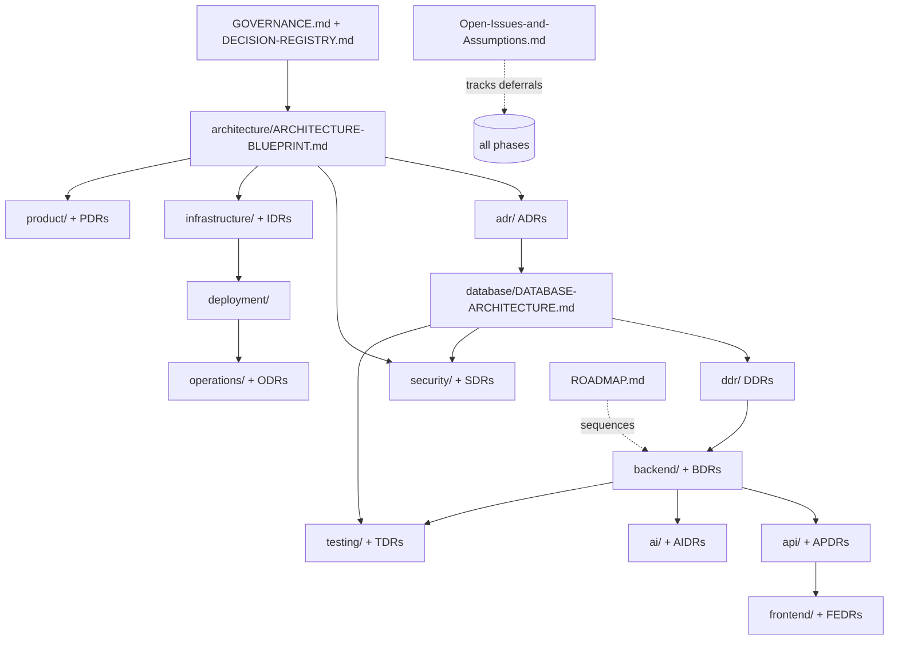

# AIIMS+ — Documentation Governance

**Version:** 1.0 · **Owner:** Engineering Leadership (CTO) · **Status:** Frozen
**Dependencies:** none (this governs all other documents) · **Last Updated:** 2026-07-04
**Review Trigger:** a new phase is added, or a governance rule proves unworkable in practice.

This document is the **engineering operating system** for AIIMS+. It defines how knowledge is recorded,
who owns it, how documents evolve, and what may and may not be changed. Every future Cowork/phase must
follow it. `/DECISION-REGISTRY.md` is the live index; this file is the ruleset.

---

## 1. Golden rules

1. **Frozen means immutable.** A document or record marked **Frozen** must not be redesigned. It may be
   changed **only** if a critical flaw is discovered in one of five areas: **security, correctness,
   scalability, compliance, or business viability** (see §6). Any such change is a **new version** with a
   superseding record — never a silent edit.
2. **Every decision is a record.** Non-trivial engineering choices become a numbered decision record of
   the phase's type (§4), using the standard template (§3).
3. **Every document is governed.** Every document carries the governance header (§2).
4. **Downstream depends on upstream, never the reverse** (§5). A phase builds on frozen upstream docs and
   does not reopen them.
5. **Deferred ≠ forgotten.** Deferred items live in `/Open-Issues-and-Assumptions.md` with a trigger.

---

## 2. Required document header (every document)

Every `.md` document — canonical docs, phase docs, and decision records — must begin with:

```
**Version:** <n.n>
**Owner:** <role>
**Status:** <Draft | Review | Accepted | Frozen | Superseded | Archived>
**Dependencies:** <docs this relies on, or "none">
**Last Updated:** <YYYY-MM-DD>
**Review Trigger:** <the condition that forces a re-review>
```

> Records authored before this governance (ADR 0001–0011, DDR 0001–0013) predate the full header; they
> are governed centrally via `/DECISION-REGISTRY.md`. New records MUST use the full template (§3).

---

## 3. Standard decision-record template (all phases)

Every decision record (ADR, DDR, BDR, APDR, FEDR, AIDR, SDR, IDR, TDR, ODR, PDR, …) uses:

```
# <PREFIX>-<NNNN> — <Title>

**Status:** <Draft | Review | Accepted | Frozen | Superseded | Archived>
**Version:** <n.n>
**Owner:** <role>
**Date:** <YYYY-MM-DD>

## Context
## Decision
## Alternatives Considered
## Trade-offs
## Consequences
## Dependencies
## Confidence            <High | Medium-High | Medium | Low>
## Reversibility         <High | Medium | Low | Very low>
## Phase Classification  <Structural Foundation | MVP Implementation | Production Implementation | Future Enhancement>
## Related Documents
## Review Trigger
```

Numbering is per-prefix, zero-padded to 4 digits, monotonic, never reused. `0000-index.md` in each
record folder lists that phase's records.

---

## 4. Decision-record type registry (one prefix per phase)

| Prefix | Record type | Folder | Owner role |
|--------|-------------|--------|------------|
| **ADR** | Architecture Decision Record | `architecture/` (+ `adr/`) | CTO / Chief Architect |
| **DDR** | Database Decision Record | `database/` (+ `ddr/`) | Database Architect |
| **BDR** | Backend Decision Record | `backend/` | Principal Engineer |
| **APDR** | API Decision Record | `api/` | API / Backend Lead |
| **FEDR** | Frontend Engineering Decision Record | `frontend/` | Frontend Lead |
| **AIDR** | AI Decision Record | `ai/` | AI Systems Architect |
| **SDR** | Security Decision Record | `security/` | Security Architect |
| **IDR** | Infrastructure Decision Record | `infrastructure/` (+ `deployment/`) | Cloud & Infra Architect |
| **TDR** | Testing Decision Record | `testing/` | QA / Engineering |
| **ODR** | Operations Decision Record | `operations/` (+ `deployment/`) | SRE / Ops Lead |
| **PDR** | Product Decision Record | `product/` | Product Strategist |
| RDR *(proposed)* | Research Decision Record | `research/` | Engineering Leadership |
| LDR *(proposed)* | Legal/Compliance Record | `legal/` | Founders + Counsel |

New phases must register their prefix here before creating records.

---

## 5. Document dependency graph

A phase inherits everything above it as **frozen foundation** and must not reopen it.



**Rule:** an arrow means "depends on and is constrained by." Editing an upstream frozen node requires the
§6 flaw process and a cascade review of everything downstream of it.

---

## 6. Documentation lifecycle

```
Draft → Review → Accepted → Frozen → Superseded → Archived
```

- **Draft** — being written; not authoritative.
- **Review** — under co-founder/peer review.
- **Accepted** — agreed; authoritative for building, still amendable.
- **Frozen** — locked; immutable except via the flaw process below.
- **Superseded** — replaced by a newer version/record; kept for history, points to its successor.
- **Archived** — no longer relevant; retained read-only.

### Changing a Frozen document — the flaw process
1. A critical flaw is identified in **security, correctness, scalability, compliance, or business
   viability** (nothing else qualifies).
2. Open an entry in `/Open-Issues-and-Assumptions.md` describing the flaw and impact.
3. Author a **new decision record** (superseding the old) and **increment the document version**; mark the
   old record **Superseded** with a pointer to the new one.
4. Run a **downstream cascade review** (§5) for anything that depended on the changed node.
5. Update `/DECISION-REGISTRY.md`.

Frozen documents are **never** edited in place for redesigns, preferences, or refactors.

---

## 7. What "frozen" currently covers

- **Phase 1 — Architecture:** `ARCHITECTURE-BLUEPRINT.md` (Frozen-core) + ADR 0001–0011.
- **Phase 2 — Database:** `DATABASE-ARCHITECTURE.md` + DDR 0001–0013.

Future Coworks treat both as immutable foundation. Deferred leaf items are tracked, not open redesigns.
