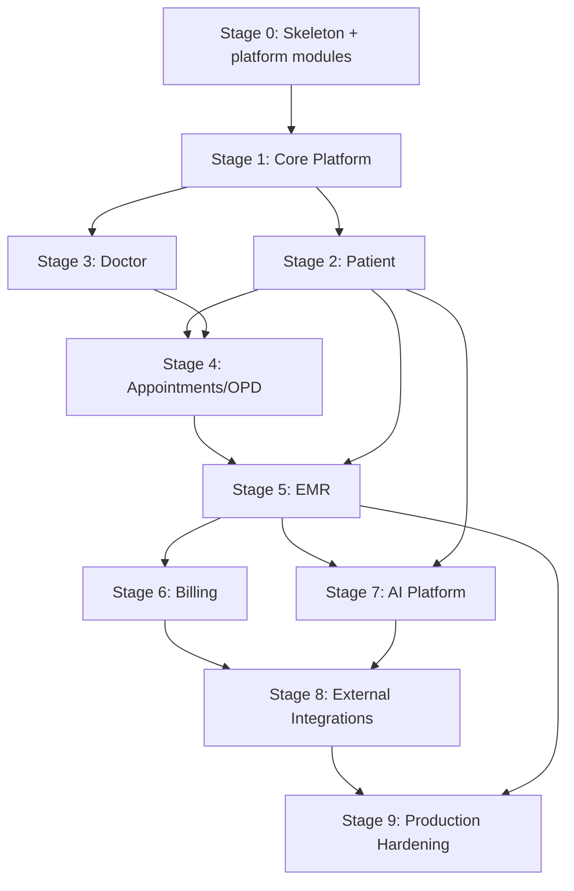

# AIIMS+ — Implementation Master Plan

**Version:** 1.0 · **Owner:** CTO / Engineering Lead · **Status:** Proposed → (Frozen on approval)
**Dependencies:** ALL frozen phases (Architecture → Operations) + Governance, Decision Registry, MVP Roadmap
**Last Updated:** 2026-07-04 · **Review Trigger:** GOVERNANCE.md §6 flaw process; stage rescope.

The canonical bridge from the **frozen architecture** to **execution**. It sequences the build into stages,
each with objectives, prerequisites, deliverables, dependencies, exit criteria, complexity, risks, and
testing. It **does not redesign** anything frozen. After this is frozen, we move into Claude Code and build
module by module against it.

> **Relationship to `ROADMAP.md`:** this plan **refines** the MVP Roadmap's three-stage shape (skeleton →
> OPD golden path → breadth) into a finer 10-stage sequence (Stage 0–9). It is consistent with it; where the
> Roadmap said "golden path," this plan decomposes it into Patient → Doctor → Appointments → EMR → Billing.

---

## 1. Executive Implementation Strategy

Build a **production-quality prototype** of the OPD experience first, on the frozen foundation, then extend
to intelligence, integrations, and production hardening. The strategy is **vertical then horizontal**:
stand up a thin end-to-end walking skeleton (Stage 0), harden the shared platform (Stage 1), then deliver
the **OPD golden path** as a demoable vertical (Stages 2–6). Only after the demoable product exists do we
add the AI plane (Stage 7), swap mocks for real integrations (Stage 8), and harden for go-live (Stage 9).

**Guiding rule (ADR 0010):** build the architecture once, integrate progressively — every external system is
mocked behind its adapter until Stage 8. The demoable investor/hospital milestone is **end of Stage 6**.

## 2. Implementation Philosophy

- **Frozen architecture is the contract.** We implement it; we do not re-litigate it (except via GOVERNANCE §6).
- **Walking skeleton first**, then one complete vertical, then breadth — never broad-but-shallow.
- **Structure before integration** — the retrofit-hostile foundations (tenancy, audit, outbox, authz,
  contracts, FHIR shape) are real from Stage 0; external systems are mocked.
- **Teach-while-building** — no code is merged that a founder cannot explain; small, reviewable PRs.
- **Every stage ships green** — tests, isolation gate, and quality gates pass before the next stage starts.
- **Demo-driven** — each stage ends with a demonstrable exit criterion.

## 3. Development Principles

1. **Test-first for the domain**; the cross-tenant isolation gate is sacred (TDR-0006).
2. **Dependency-inward** (BDR-0001/0013): domain has no framework/ORM/HTTP imports; Drizzle only in `packages/db`.
3. **Contracts are truth** (`domain-types`, `api-contracts`, `event-schemas`) — generate, don't hand-write.
4. **One transaction = one tenant + write + outbox + audit** (BDR-0004).
5. **No PHI in logs/telemetry/prompts/non-prod data** (SDR-0004/0010).
6. **Feature-flag every integration and risky feature** (ADR 0010).
7. **Small vertical slices** over big horizontal layers — each PR is shippable.

## 4. Repository Structure

Single **monorepo** (pnpm workspaces + Turborepo), as fixed in Blueprint §6 / BDR-0001:

```
aiims-plus/
├── apps/
│   ├── api/         # NestJS modular monolith
│   ├── web/         # Next.js web app (+ BFF)
│   └── ai/          # Python FastAPI AI plane (own deps)
├── packages/
│   ├── domain-types/    api-contracts/    event-schemas/
│   ├── ui-web/          ui-native/        design-tokens/
│   ├── authz/           config/           db/           testing/
├── infra/           # Terraform (IDR-0012)
├── tooling/         # eslint/tsconfig/CI scripts/boundary rules
└── docs/            # the frozen architecture set (this repo of docs)
```
*(mobile app `apps/mobile` (Expo) is added at the frontend build-out; scaffolded lazily.)*

## 5. Monorepo Layout (ownership & boundaries)

- **Apps are thin**; logic lives in `packages/*` and API modules.
- **ESLint import-boundary rules + Turborepo graph** enforce dependency direction (BDR-0013); violations fail CI.
- `domain-types` and `event-schemas` are the only cross-cutting truth; **ORM types never leave `packages/db`**.
- Each bounded-context API module (`apps/api/src/modules/<ctx>`) owns its schema (DB §schemas, DDR 0004).

## 6. Package Dependency Order (build/bootstrap sequence)

Bootstrap packages in this order (each depends only on earlier ones):
1. `tooling` (tsconfig/eslint/boundaries) → 2. `domain-types` → 3. `config` → 4. `event-schemas` →
5. `api-contracts` → 6. `db` (Drizzle schema + RLS migrations + tenant-context helper) → 7. `authz` →
8. `testing` (incl. isolation harness) → 9. `design-tokens` → 10. `ui-web` / `ui-native`.
Apps (`api`, `web`, `ai`, `mobile`) depend on the packages, never the reverse.

## 7. Stage-by-Stage Development Roadmap (overview)

| Stage | Name | Milestone | Complexity | Demo outcome |
|---|---|---|---|---|
| 0 | Walking Skeleton | A — Foundation | L | Authenticated, multi-tenant, audited app deployed; isolation gate green |
| 1 | Core Platform | A — Foundation | L | Tenant/org/facility/dept + users/roles (RBAC) + reference data |
| 2 | Patient Module | B — OPD Golden Path | M | Register/search/view patient (encrypted ids, mock ABHA) |
| 3 | Doctor Module | B | S–M | Manage practitioners linked to users/departments |
| 4 | Appointments / OPD | B | M | Book/reschedule/check-in; no double-booking; encounter opened |
| 5 | EMR | B | L | Document encounter (notes/vitals/diagnosis), orders + results, sign |
| 6 | Billing | B | M | Invoice an encounter; mock payment; **demoable OPD vertical complete** |
| 7 | AI Platform | C — Intelligence | L | AI gateway + one flagged operational capability (HITL, evals green) |
| 8 | External Integrations | C | XL | Real ABDM sandbox (M1→M3), consent, payments, notifications (flagged) |
| 9 | Production Hardening | D — Production | XL | Prod-readiness checklist green → go-live |

Complexity: S ≈ ~1 sprint, M ≈ 1–2, L ≈ 2–3, XL ≈ 3+ (2-week sprints, small team; estimates, not commitments).

## 8. Module Dependency Graph


Platform modules (tenant-context, auth, authz, audit, outbox, event-bus, config, flags, adapters) from
Stage 0–1 are prerequisites for **all** domain stages.

## 9. Sprint / Milestone Plan

- **2-week sprints**, trunk-based (§26). Each sprint ends with green gates + a demo of progress.
- **Milestone A (Foundation):** Stages 0–1 — the platform everything builds on.
- **Milestone B (OPD Golden Path / DEMO):** Stages 2–6 — the investor/hospital-demoable vertical. **Primary
  near-term goal.**
- **Milestone C (Intelligence + Integrations):** Stages 7–8.
- **Milestone D (Production):** Stage 9 → go-live.
Milestone reviews are Operational Readiness Reviews (ODR-0013) scaled to the milestone.

---

## 10. Stage 0 — Walking Skeleton

- **Objectives:** a deployed, authenticated, multi-tenant, audited application that does nothing clinical yet
  — every retrofit-hostile foundation in place.
- **Prerequisites:** frozen architecture; AWS dev account + Terraform bootstrap (IDR-0001/0012); Prisma-vs-
  Drizzle confirmed = Drizzle (ADR 0011).
- **Deliverables:** monorepo + tooling + package bootstrap (§6); NestJS `api` skeleton; **tenancy substrate**
  (`tenant_id` + RLS + `FORCE` + tenant-context middleware, DDR 0002/0003); **Keycloak dev** + OIDC + in-app
  RBAC skeleton (SDR-0001/0002); **audit outbox + event bus** (DDR 0007, BDR 0005); **feature-flag** framework;
  **adapter/mock convention** (ports for ABDM/consent/payment/notification/AI); API conventions + error
  envelope (APDR-0003); CI pipeline with **cross-tenant isolation gate** (TDR-0006) + scans; deploy to
  `ap-south-1` dev via Terraform (IDR-0011).
- **Dependencies:** none (this is the base).
- **Exit criteria:** a user logs in (Keycloak), is scoped to a tenant; a trivial tenant-scoped write is
  audited via the outbox; **isolation gate green**; app deployed to dev; all mock adapters resolve.
- **Estimated complexity:** L (2–3 sprints).
- **Risks:** RLS misconfiguration (mitigate: isolation gate from day one); over-scoping the skeleton (keep it
  feature-free); Drizzle v1.0 stability (confirm at kickoff, ADR 0011 guardrail).
- **Testing requirements:** unit (tenant-context helper), integration (Testcontainers Postgres + RLS as
  `aiims_app`), **isolation suite green (blocking)**, CI scans green, deploy smoke test.

## 11. Stage 1 — Core Platform

- **Objectives:** the shared platform domain everything else needs — org structure, identity mapping, RBAC,
  reference data.
- **Prerequisites:** Stage 0 complete.
- **Deliverables:** `platform` schema + modules — tenant registry, organization, facility, department,
  `app_user` (Keycloak-sub mapping), role, user_role, feature_flag (DB §5); **RBAC PDP** in `packages/authz`
  (SDR-0002) enforced by guards; **reference** code systems (ICD-10/SNOMED/LOINC seed, DDR 0012);
  observability wiring (OTel, structured no-PHI logs, IDR-0013).
- **Dependencies:** Stage 0 platform modules.
- **Exit criteria:** an admin can create a tenant → org → facility → departments and users with roles;
  RBAC denies/permits correctly; reference codes queryable; every action audited.
- **Estimated complexity:** L (2–3 sprints).
- **Risks:** authz model too rigid/loose (keep RBAC now, ABAC-ready); reference-data sourcing (seed minimal
  sets first).
- **Testing requirements:** unit (authz policies), integration (org hierarchy + tenant-scoped FKs, DDR 0008),
  authz negative tests, isolation suite green, contract tests for platform APIs.

## 12. Stage 2 — Patient Module

- **Objectives:** register, search, view, and update patients — the first clinical entity.
- **Prerequisites:** Stage 1 complete.
- **Deliverables:** `clinical.patient` (FHIR Patient shape, DDR 0005) with **field-encrypted identifiers**
  (ABHA/phone/email + blind index, DDR 0006/SDR-0004); registration + demographics APIs (APDR contracts);
  patient search (Postgres FTS, Blueprint §17); **mock ABDM M1** ABHA create/verify behind the adapter;
  patient UI in `web` (auth-aware, FEDR-0008).
- **Dependencies:** Stage 1 (users/roles), Stage 0 adapters (mock ABDM).
- **Exit criteria:** register a patient with encrypted identifiers + (mock) ABHA; search by name/MRN;
  view/update; all tenant-scoped + audited; FHIR Patient regenerable.
- **Estimated complexity:** M (1–2 sprints).
- **Risks:** encryption vs searchability (blind index, DDR 0006); FHIR field completeness (do the India-
  profile field audit here, Open Issue).
- **Testing requirements:** unit (patient domain), integration (encryption/blind-index lookup, RLS), contract
  (patient API + FHIR mapping), isolation suite green, a11y on patient screens.

## 13. Stage 3 — Doctor Module

- **Objectives:** manage practitioners and link them to platform users and departments.
- **Prerequisites:** Stage 1 complete (Stage 2 parallelizable).
- **Deliverables:** `clinical.practitioner` (FHIR Practitioner/PractitionerRole, DDR 0005); link to
  `app_user` + department; specialty codings (reference, DDR 0012); practitioner admin UI.
- **Dependencies:** Stage 1.
- **Exit criteria:** create/manage practitioners, associate with users + departments + specialties;
  authorization reflects clinician roles; audited.
- **Estimated complexity:** S–M (~1 sprint).
- **Risks:** overlap with `app_user`/roles (keep practitioner as clinical profile over the platform user).
- **Testing requirements:** unit, integration (practitioner↔user↔department FKs, tenant-scoped), contract,
  isolation suite green.

## 14. Stage 4 — Appointments / OPD

- **Objectives:** schedule and check in outpatient visits; open encounters.
- **Prerequisites:** Stages 2 & 3 complete.
- **Deliverables:** `SchedulingModule` + `clinical.appointment` (FHIR Appointment, DDR 0005); **slot
  exclusion constraint** preventing double-booking (`btree_gist`, DDR 0009); book/reschedule/cancel/no-show;
  check-in → open `clinical.encounter`; scheduling UI (front-desk role).
- **Dependencies:** Patient (Stage 2), Doctor (Stage 3).
- **Exit criteria:** front-desk books a patient with a doctor; **double-booking is rejected by the DB**;
  reschedule/cancel/no-show work; check-in opens an encounter; audited.
- **Estimated complexity:** M (1–2 sprints).
- **Risks:** concurrency/double-booking (DB exclusion constraint + optimistic concurrency, DDR 0009);
  timezone handling (store `timestamptz`, DB §4).
- **Testing requirements:** unit (scheduling rules), integration (**concurrent double-booking rejected**),
  contract, E2E (book→check-in), isolation suite green.

## 15. Stage 5 — EMR

- **Objectives:** document the OPD encounter and manage orders/results — the clinical heart, Constitution-bound.
- **Prerequisites:** Stage 4 complete.
- **Deliverables:** `clinical.encounter` (FHIR Encounter); `clinical_note` (documentation, **clinician
  signs**, versioned amendments, DDR 0013); `observation` (vitals, LOINC); `condition` (diagnosis, ICD-10/
  SNOMED); `orders.service_request` (lab/imaging) + `orders.diagnostic_report` (results); large text/files to
  **S3 via presigned URLs** (APDR-0007); EMR UI with **sign/finalize** (doctor-only, Constitution).
- **Dependencies:** Encounter (Stage 4), Patient (Stage 2).
- **Exit criteria:** a doctor documents a full OPD encounter (notes/vitals/diagnosis), places orders, records
  results, and **signs**; amendments create new versions; FHIR bundle regenerable; audited.
- **Estimated complexity:** L (2–3 sprints).
- **Risks:** clinical data modeling breadth (stick to OPD scope); versioning/amendment correctness (DDR 0013);
  **Constitution** — AI must not appear here yet, sign is human-only.
- **Testing requirements:** unit (encounter/versioning invariants), integration (orders↔results, S3 presign),
  contract (+ FHIR mapping conformance), E2E (full documentation flow), isolation suite green, a11y.

## 16. Stage 6 — Billing

- **Objectives:** invoice an encounter and (mock) take payment — completes the demoable OPD vertical.
- **Prerequisites:** Stage 5 complete.
- **Deliverables:** `billing.invoice` + `invoice_line`; charge capture from encounter/orders; **mock payment
  gateway** behind the adapter (real in Stage 8); invoice UI; **mock ABDM share-on-consent** (care context +
  mock consent artifact + FHIR bundle) to close the golden path.
- **Dependencies:** EMR (Stage 5).
- **Exit criteria:** generate an invoice for an encounter, view/settle via mock payment; **the full golden
  path (register → schedule → consult → document → order/result → invoice → mock share) is demoable**.
- **Estimated complexity:** M (1–2 sprints).
- **Risks:** money handling (numeric, DB §4; never float); scope creep into full revenue-cycle (keep MVP-lean).
- **Testing requirements:** unit (billing math), integration (invoice↔encounter, mock payment idempotency),
  contract, **E2E of the entire OPD golden path**, isolation suite green. **Milestone B demo gate.**

## 17. Stage 7 — AI Platform

- **Objectives:** stand up the operational-only AI plane with one flagged capability — Constitution-compliant.
- **Prerequisites:** Stage 5 (clinical data to assist on); Milestone B ideally demoable.
- **Deliverables:** `AiGatewayModule` port + **isolated Python `ai` plane** (AIDR-0002/0003); **pgvector**
  RAG on tenant data (AIDR-0006); **redaction pipeline** (AIDR-0008); one operational capability behind a
  **feature flag + HITL + eval gate** (e.g. medical-coding suggestion or documentation draft, AIDR-0010/0012);
  **AI audit** (AIDR-0011).
- **Dependencies:** EMR (Stage 5), Patient (Stage 2), platform.
- **Exit criteria:** the AI gateway serves one capability as a **human-reviewed suggestion** (never auto-
  applied), PHI-redacted before any model call, fully audited, **safety/PHI/injection evals green**; AI
  failure does not block care (AIDR-0014).
- **Estimated complexity:** L (2–3 sprints).
- **Risks:** Constitution violation (evals gate + HITL + no write path); PHI to external models (redaction +
  residency, AIDR-0004 — resolve LLM-residency open item here); second runtime ops (isolated plane).
- **Testing requirements:** unit, **AI safety/boundary/PHI-leak/injection evals (release-blocking, TDR-0007)**,
  integration (gateway + redaction + audit), isolation suite green.

## 18. Stage 8 — External Integrations

- **Objectives:** swap mocks for real external systems, progressively, behind the same adapters.
- **Prerequisites:** the mock flows they replace are complete and demoable; provider/residency decisions
  (AIDR-0004) and legal items as needed.
- **Deliverables:** **real ABDM** sandbox → production path (M1 ABHA → M2 HIP → M3 HIU + consent, ADR 0006);
  **DPDP + ABDM Consent Manager** wiring (ADR 0004); **real payment gateway**; **real notification** providers
  (SMS/email); each behind its feature flag with contract tests. Optional: outbound signed webhooks (APDR-0010).
- **Dependencies:** Consent (built in Stage 2+), Billing (Stage 6), AI (Stage 7) as applicable.
- **Exit criteria:** at least the **ABDM sandbox HIP/HIU + consent** path certified; real payments +
  notifications working behind flags; mocks swappable by config with no domain change.
- **Estimated complexity:** XL (3+ sprints; gated by external certification timelines).
- **Risks:** ABDM/DPDP spec churn + certification lead time (adapters isolate; start sandbox early); external
  reliability (retries/DLQ, fail-safe).
- **Testing requirements:** contract tests per adapter, sandbox conformance (NHA validators), integration
  (consent-gated sharing), security tests, isolation suite green.

## 19. Stage 9 — Production Hardening

- **Objectives:** clear the production-readiness bar and go live.
- **Prerequisites:** Stages 0–8 complete for the go-live scope.
- **Deliverables:** **MFA/SSO** (SDR-0001); **WORM audit + integrity verifier** (DDR 0007/ODR-0011);
  **cross-region DR + game-day** (IDR-0014/ODR-0012); **retention + crypto-shred engine + legal durations**
  (ADR 0009 — resolve C-1/C-2); **external pen-test** + criticals closed (TDR-0008); **per-tenant CMK** for
  dedicated tenants (SDR-0005); SIEM/anomaly detection; **offline-PHI device posture sign-off** (FEDR-0010);
  SLOs/dashboards/alerts/on-call/runbooks live (ODR); DPDP/ABDM go-live duties operational.
- **Dependencies:** all prior stages; legal + security sign-offs.
- **Exit criteria:** the **Production Readiness Checklist (ODR-0013 / TDR-0014) is fully green** — no red item.
- **Estimated complexity:** XL (3+ sprints; partly gated by legal/pen-test/DR-drill).
- **Risks:** legal retention decisions (start early, parallel); pen-test findings (buffer time); DR-drill
  failures (rehearse in staging first).
- **Testing requirements:** full regression, DR + restore drill passed, pen-test criticals closed, a11y AA,
  perf within SLOs, isolation + AI evals green, audit integrity verified.

---

## 20. Definition of Done (every stage)

A stage is **Done** only when ALL hold:
- [ ] Code implements the frozen design for that scope; no architecture reopened (or GOVERNANCE §6 followed).
- [ ] **Unit + integration + contract tests** written and green; **cross-tenant isolation suite green**.
- [ ] Coverage meets policy (domain/critical ≥ 90%, overall ≥ 80%, new-code ratchet; TDR-0012).
- [ ] CI security scans (SAST/dep/secret/container/IaC) green; import-boundary lint green.
- [ ] **No PHI** in logs/telemetry; audit emitted for all relevant actions.
- [ ] Deployed to **staging**; smoke tests pass.
- [ ] **Exit criteria demoed** to the team.
- [ ] Docs updated (relevant xDRs / registry if a decision was made); runbook stubs where operational.
- [ ] No open critical/security issues.

## 21. Acceptance Criteria (per stage)

Acceptance = the stage's **Exit criteria (§10–§19)** demonstrated on staging with **synthetic data**, by the
intended role (admin/front-desk/doctor), tenant-scoped and audited, with the relevant E2E flow green. AI
stages additionally require **safety evals green**; integration stages require **contract/sandbox conformance**.

## 22. Testing Requirements Before Moving Between Stages

**Gate to advance:** the current stage's DoD (§20) is fully met **and** the cumulative E2E suite (all prior
stages) is green — no regressions. Specifically: isolation suite green (always), contract tests green,
stage E2E green, coverage ratchet not lowered, security scans clean. **A red gate blocks the next stage.**
Milestone B additionally requires the **full OPD golden-path E2E** green (Stage 6).

## 23. Deployment Checkpoints

- **Every merge to `main`** → CI gates → auto-deploy to **dev**.
- **End of each stage** → promote to **staging** (canary), run E2E/perf/smoke (IDR-0015).
- **End of each milestone** → Operational Readiness Review (ODR-0013).
- **Production** → only after Stage 9 readiness checklist green; canary blue/green with auto-rollback.

## 24. Risks & Mitigation (program-level)

| Risk | Severity | Mitigation |
|---|---|---|
| Two-founder execution scope | High | Strict staging; walking skeleton + one vertical first; automate toil (ODR-0001) |
| RLS/tenant isolation regression | **Critical** | Isolation gate merge-blocking from Stage 0 (TDR-0006) |
| Scope creep per stage | High | DoD + exit criteria + demo gates; MVP-lean scope |
| ABDM/DPDP certification lead time | Medium | Mocks decouple MVP; start sandbox early in Stage 8 |
| Constitution drift in AI | High | Evals + HITL + no write path (Stage 7 gates) |
| Legal retention/SDF unresolved at go-live | Medium | Start C-1/C-2 with counsel during Stages 2–6, well before Stage 9 |
| PHI leakage (logs/AI/non-prod) | High | No-PHI lint, redaction, synthetic-only test data (SDR-0004/0010, TDR-0013) |
| Drizzle v1.0 maturity | Medium | Confirm at Stage 0; Prisma fallback; ORM confined to `packages/db` |

## 25. Team Workflow

- **Small team, vertical ownership:** a founder owns a slice end-to-end (API→domain→DB→UI) per the layered
  design; pair on security-critical code (RLS, crypto, authz).
- **Cadence:** 2-week sprints; sprint planning → build → demo → retro. Daily lightweight sync.
- **Teach-while-building:** the reviewing founder must understand every merged change (project rule).
- **Backlog:** stages → epics → stage-scoped issues; reliability/toil backlog runs continuously (ODR-0014).

## 26. Git Workflow

- **Trunk-based** with **short-lived feature branches**; `main` is always releasable.
- **Conventional Commits** (`feat:`, `fix:`, `chore:`…) for readable history + automated release notes.
- **PRs are small and reviewable**; CI gates (TDR-0012/IDR-0011) must be green to merge; no direct pushes to `main`.
- **Immutable image per merge**, promoted through envs (IDR-0015).

## 27. Branch Strategy

- `main` — protected, always releasable, auto-deploys to dev.
- `feature/<stage>-<slug>` — short-lived, one slice; rebased onto `main`; deleted on merge.
- `hotfix/<slug>` — urgent prod fix; fast-tracked with the same gates; back-merged.
- No long-lived divergent branches (avoids the coordination cost the monorepo is meant to remove).

## 28. Code Review Policy

- **≥1 reviewer** for all PRs; **≥2 / security review** for changes to **RLS, tenancy, authz, crypto,
  secrets, migrations, or infra** (SDR-0012, TDR-0008).
- **Merge-block on red gates** (isolation, evals, scans, coverage ratchet).
- **Explainability rule:** a founder cannot approve/merge code they cannot explain (teach-while-building).
- Reviews check: architecture conformance, boundary rules (BDR-0013), tests, no PHI in logs, error/PHI safety.

## 29. Coding Standards

- **TypeScript strict**; ESLint (incl. **import-boundary** + **no-PHI-in-logs** rules); Prettier.
- **Naming** per DB/Backend conventions (snake_case DB, camelCase API, singular tables).
- **Dependency-inward** (BDR-0001/0013); **Drizzle only in `packages/db`**; repositories return domain objects.
- **Validation** via shared Zod (`domain-types`); **money** as decimal, **time** as `timestamptz`.
- **No secrets/PHI in code, logs, or fixtures**; feature-flag integrations.
- Python (`ai` plane): typed (mypy), FastAPI, same no-PHI/redaction rules.

## 30. Documentation Standards

- **Frozen docs are canonical** and immutable except via GOVERNANCE §6; the docs repo travels with the code.
- **New decisions → a new xDR** (correct prefix) using the standard template; **update the Decision Registry**.
- Every doc carries the **governance header** (Version/Owner/Status/Dependencies/Last Updated/Review Trigger).
- Runbooks/postmortems are living docs (ODR-0014); code has doc-comments for public interfaces + READMEs per app.

## 31. Progress Tracking Strategy

- **Stage completion ledger** (mirrors the phase ledger): each stage tracked Not-started → In-progress →
  Done (DoD met) → Demoed → Promoted-to-staging.
- **Issues mapped to stage/epic**; DoD checklist on each stage; **DORA + quality KPIs** from Testing/Ops
  (TDR-0014/ODR-0014) tracked from Stage 0.
- **Milestone reviews (ORR)** gate progression; the Decision Registry remains the source of truth for decisions.

## 32. Final Implementation Checklist (pre-build)

Before writing Stage 0 code, confirm:
- [ ] This plan is **approved and frozen**; registered in the Decision Registry.
- [ ] AWS dev account + Terraform bootstrap ready (IDR-0001/0012).
- [ ] Drizzle confirmed (ADR 0011); Keycloak dev realm plan ready (SDR-0001).
- [ ] Repo created; branch protection + CI skeleton with the **isolation gate** wired first (TDR-0006).
- [ ] Package bootstrap order agreed (§6); import-boundary lint configured (BDR-0013).
- [ ] Synthetic test-data generators planned (no PHI, TDR-0013).
- [ ] OPD hero flow confirmed as the Milestone-B target (already confirmed).
- [ ] Open items owned with triggers (legal retention/SDF, offline-PHI posture, LLM residency).

**On approval, we stop planning and begin Stage 0 in Claude Code — building AIIMS+ module by module against
this plan and the frozen architecture.**

*End of Implementation Master Plan v1.0.*
