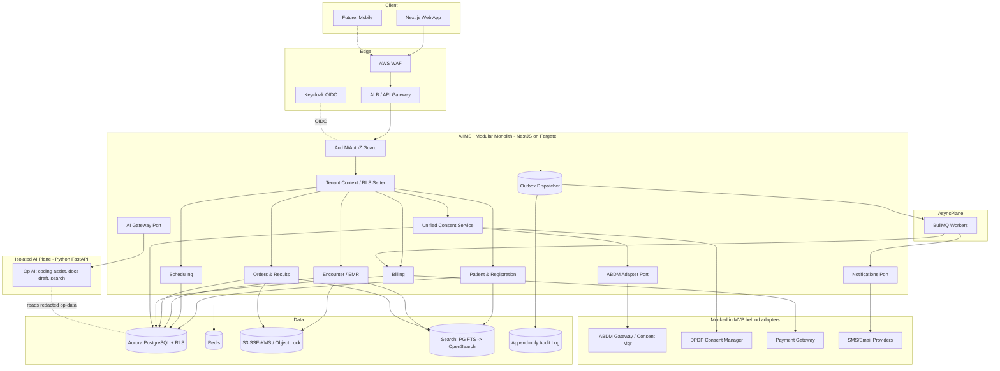

# AIIMS+ — Canonical Architecture Blueprint

**Version:** 1.1 (Adopted — Canonical, Frozen-core) · **Date:** 2026-07-04 · **Market:** India v1 (ABDM / DPDP)
**Owner:** CTO / Chief Architect · **Status:** Frozen-core · **Dependencies:** adr/ADR-0001..0011
**Last Updated:** 2026-07-04 · **Review Trigger:** GOVERNANCE.md §6 flaw process only
**Authoring authority:** Engineering Leadership (CTO / Chief Architect)
**Adoption:** Ratified by founders 2026-07-04 as the **canonical architecture for AIIMS+**. The frozen
core is authoritative for all future engineering work. Deferred items remain explicitly documented and
are revisited only when their triggering conditions are met.
**Governing rule:** ADR 0010 — *Build the architecture once. Integrate progressively.*
**Status:** **FROZEN-CORE (ADOPTED)** — the architecture below is authoritative for all downstream
Coworks (Database, Security, DevOps, AI, Frontend). Deferred leaf items (see §33) do not alter any
interface or boundary defined here, so downstream work proceeds safely. **Stage 1 hero flow: OPD
(confirmed).**

> This document supersedes nothing in the ADR set — it **consolidates** ADRs 0001–0011, the MVP
> Roadmap, and the Open Issues log into one canonical blueprint. Where an ADR and this document ever
> disagree, the ADR is the system of record for that single decision and this document is corrected.
> If `FOUNDER-A-CONTEXT-PACK.md` is later supplied and conflicts, it wins (per project charter).

---

## 1. Executive Architecture Summary

AIIMS+ is a multi-tenant, India-first Hospital Operating System delivered as a **modular monolith** on
AWS (`ap-south-1`), written in **TypeScript (NestJS)** with a **Drizzle + PostgreSQL** data layer, a
**Next.js** web frontend, and a strictly-bounded **operational-only AI plane**. Clinical data is modeled
relationally but is **FHIR-R4-regenerable** so ABDM interoperability is a mapping concern, not a rewrite.
Tenant isolation is enforced in the database via **PostgreSQL Row-Level Security**. Every state change
flows through a **transactional outbox** that feeds an event bus, an **append-only tamper-evident audit
log**, and asynchronous jobs.

The defining strategy is **structure-now, integrate-later**: all retrofit-hostile foundations (tenancy,
audit, event/outbox, authz model, API contracts, FHIR-shaped model, adapter interfaces, feature flags)
are built in the MVP; all external integrations (ABDM, DPDP Consent Managers, payments, notifications,
production identity) live behind stable adapter interfaces and run as **mocks** until the Production
phase. The result is a production-quality prototype that is a strict *subset* of the production system,
never a detour from it.

**Non-negotiable guardrails (Constitution, Master Ch. 19):** no clinical AI, no diagnosis, no medicine
recommendations; doctors make all clinical decisions; security, privacy, and audit are mandatory
platform capabilities. AI is permitted for operations only.

**Overall confidence in this blueprint: High** for structure and boundaries; **Medium** for a small set
of leaf choices (search engine at scale, DR numbers, AI-plane timing) explicitly deferred in §33.

---

## 2. Guiding Engineering Principles

1. **Build once, integrate progressively** (ADR 0010) — mock integrations, keep structure.
2. **Boring, reliable technology by default** — novelty must earn its place with measurable benefit.
3. **Security and tenancy enforced at the database, not trusted to application code.**
4. **Clear module boundaries; no hidden coupling** — modules talk through explicit interfaces/events.
5. **Everything auditable** — if it changes PHI or security state, it emits an audit event.
6. **FHIR at the boundary, pragmatic model inside.**
7. **Stateless services; state lives in Postgres, Redis, or S3** — enables horizontal scale.
8. **Contracts before code** — API and event schemas are shared, versioned artifacts.
9. **Reversibility where cheap; deliberate commitment where not** — ADRs record the irreversible ones.
10. **Teach-while-building** — no code merges that a founder cannot explain; favor transparent tools.

---

## 3. Final Technology Stack (with rationale)

| Layer | Choice | Why | Alternatives rejected | Confidence |
|---|---|---|---|---|
| Language (backend) | **TypeScript** | One language across stack; strong typing for a large domain; large talent pool. | Go/Java (more ops boilerplate, slower iteration for a small team); Python for core (weaker for large transactional API). | High |
| Backend framework | **NestJS** | Opinionated modular structure enforces bounded contexts; DI, guards, interceptors fit authz/audit cross-cutting concerns. | Express alone (too unstructured at scale); Fastify (less structure); Java/Spring (heavier). | High |
| ORM / data layer | **Drizzle** | Native Postgres RLS, SQL-first control over JSONB/indexes for FHIR shapes, transparent SQL (ADR 0011). | Prisma 7 (sanctioned fallback; weaker native RLS/JSONB control). | Med-High |
| Database | **PostgreSQL (Aurora)** | ACID, RLS, JSONB, FTS, partitioning, mature. Non-negotiable for healthcare integrity. | MySQL (weaker RLS/JSONB); NoSQL (loses relational integrity). | High |
| Cache / ephemeral | **Redis (ElastiCache)** | Cache-aside, rate limiting, job queue backend. | Memcached (fewer features). | High |
| Background jobs | **BullMQ on Redis** (MVP) | Reuses Redis; mature; good NestJS fit. Extract to SQS/Kafka at scale. | pg-boss (fine, but keeps load on primary DB); Kafka now (over-heavy for 2 founders). | High |
| Frontend | **Next.js + React + TypeScript** | SSR/RSC shell + rich client app; shared TS types with backend. | SPA-only (worse first-load/SEO for marketing surfaces); Angular (heavier). | High |
| UI system | **Tailwind + shadcn/ui (Radix)** | Accessible primitives, fast delivery, owned components (no lock-in). | MUI/AntD (heavier, harder to theme for a healthcare design system). | High |
| Client data | **TanStack Query + Zustand** | Server-state caching + minimal client state; forms via React Hook Form + Zod. | Redux (boilerplate-heavy). | High |
| Identity | **Keycloak** (self-hosted, `ap-south-1`) | OIDC/MFA/SSO out of the box, in-region, no per-MAU cost (ADR 0008). | Cognito (managed but less flexible, per-MAU); build-your-own (liability). | Med-High |
| AI plane | **Python (FastAPI) service, isolated** | ML/NLP ecosystem is Python; kept behind an adapter, operational-only. | Node-only AI (unrealistic); embedding AI in core (couples runtimes). | High (boundary) / Med (timing) |
| Object storage | **S3 (SSE-KMS, Object Lock)** | Durable, cheap, presigned access, WORM for audit/imaging. | DB blobs (bloats DB); self-managed storage (ops burden). | High |
| Search | **Postgres FTS (MVP) → OpenSearch (scale)** | Avoid a search cluster early; promote when cross-entity/FHIR search demands it. | Elasticsearch/OpenSearch on day one (premature ops). | Med-High |
| IaC | **Terraform** | Declarative, reviewable, multi-account; industry standard. | CDK (ties to TS but more churn); ClickOps (unreproducible). | High |
| Runtime/orchestration | **ECS Fargate** | Serverless containers; no cluster to run; right-sized for a small team (ADR 0001). | EKS/Kubernetes (unstaffable now); EC2 (patching burden). | High |
| CI/CD | **GitHub Actions** | Native to repo, mature, cheap. | Jenkins (ops heavy). | High |
| Observability | **OpenTelemetry → managed backend** | Vendor-neutral instrumentation; avoids lock-in. | Proprietary agents only. | High |
| Monorepo tooling | **pnpm workspaces + Turborepo** | Fast, cache-aware builds; shared packages. | Nx (heavier); polyrepo (coordination cost). | High |

---

## 4. Overall System Architecture

A single deployable **modular monolith** (the AIIMS+ API) organized into strict NestJS modules per
bounded context, backed by one Aurora PostgreSQL cluster with RLS, fronted by an API gateway/ALB, with
Redis, S3, an isolated Python AI service, and Keycloak as supporting planes. External systems (ABDM,
DPDP Consent Managers, payment/notification providers) are reached only through **adapter modules** that
default to mock implementations selected by feature flags. All writes emit domain events via a
transactional outbox that fans out to the audit log, async jobs, and (later) extracted services.

Layering: **Presentation** (Next.js) → **API Gateway/Edge** (ALB + WAF, auth at the edge via OIDC) →
**Application/Domain** (NestJS modules) → **Integration Adapters** (ABDM, consent, payments,
notifications, AI) → **Data Platform** (Postgres, Redis, S3, Search) → **Infrastructure** (AWS).

---

## 5. High-Level Architecture Diagram



*(MVP: `ABDMX`, `DPDPX`, `PAY`, `SMS` are mock implementations; `SR` is Postgres FTS; the AI plane is
feature-flagged and may be a stub. All ports/interfaces are real from day one.)*

---

## 6. Monorepo Structure

**Tooling:** pnpm workspaces + Turborepo. One repository, many packages; apps are thin, logic lives in
packages and the API modules.

```
aiims-plus/
├── apps/
│   ├── api/                 # NestJS modular monolith (the core system)
│   ├── web/                 # Next.js web application
│   └── ai/                  # Python FastAPI AI plane (separate runtime, own deps)
├── packages/
│   ├── domain-types/        # FHIR-aligned domain types + Zod schemas (source of truth)
│   ├── api-contracts/       # OpenAPI / ts-rest contracts shared by api + web
│   ├── event-schemas/       # Versioned domain event definitions (outbox payloads)
│   ├── ui/                  # Design system: Tailwind + shadcn/ui components
│   ├── authz/               # Authorization policy model + helpers (RBAC now, ABAC-ready)
│   ├── config/              # Typed config + feature-flag client
│   ├── db/                  # Drizzle schema, RLS policy migrations, data-access conventions
│   └── testing/             # Test utils incl. the cross-tenant isolation harness
├── infra/                   # Terraform (VPC, Aurora, ECS, S3, Redis, KMS, Keycloak)
├── tooling/                 # lint, tsconfig, CI scripts, module-boundary rules
└── docs/                    # ADRs, this blueprint, Open Issues
```

**Boundary enforcement:** ESLint import-boundary rules + Turborepo graph prevent modules reaching into
each other's internals. `domain-types` and `event-schemas` are the only cross-cutting truth; ORM types
never leak past `packages/db` (keeps the ADR 0011 fallback survivable).

---

## 7. Backend Architecture (NestJS module boundaries)

Each **bounded context** is a NestJS module owning its own service layer, repository (via `packages/db`),
DTOs, and event handlers. Modules expose a narrow public interface and communicate **only** through that
interface or through domain events — never by importing another module's internals or querying another
module's tables directly.

**Platform modules (Structural Foundation, MVP):**
- `TenantContextModule` — resolves tenant from the OIDC token, sets the Postgres RLS session variable
  per request/transaction. The single choke point for isolation.
- `AuthModule` — OIDC verification, session, guards; delegates identity to Keycloak.
- `AuthzModule` — RBAC policy evaluation (user/role/department/org/resource).
- `AuditModule` — subscribes to the outbox; writes the append-only hash-chained log.
- `OutboxModule` — transactional outbox table + dispatcher to in-process bus and BullMQ.
- `FeatureFlagModule`, `ConfigModule`, `ObservabilityModule`.
- Adapter modules: `AbdmAdapterModule`, `ConsentModule`, `PaymentAdapterModule`,
  `NotificationAdapterModule`, `AiGatewayModule` — each interface-first with a mock default.

**Domain modules (MVP Implementation, OPD golden path):**
- `PatientModule` (registration, demographics, ABHA field)
- `SchedulingModule` (appointments)
- `EncounterModule` (OPD visits, clinical documentation)
- `OrdersModule` (lab/radiology orders + results)
- `BillingModule` (invoicing; payment via adapter)
- Later: `PharmacyModule`, `LabModule`, `IPDModule`, `ReportingModule`.

**Cross-cutting concerns** are implemented as NestJS interceptors/guards: authn, authz, tenant-context,
audit-emit, request logging, and error envelope — applied globally so no module can forget them.

---

## 8. Frontend Architecture

**Next.js (App Router) + React + TypeScript.** Server Components render the authenticated shell and
static/marketing surfaces; the clinical application runs as a rich client using **TanStack Query** for
server-state (caching, invalidation, optimistic updates) and **Zustand** for the little local UI state
that isn't server-derived. Forms use **React Hook Form + Zod**, with the *same Zod schemas* shared from
`packages/domain-types` so client and server validate identically.

- **Auth:** OIDC via Keycloak; tokens handled server-side (Next route handlers / BFF pattern) so the
  browser never holds long-lived secrets. All API calls carry the tenant-scoped token.
- **API access:** typed client generated from `api-contracts` — no hand-written fetch types.
- **Design system:** `packages/ui` (Tailwind + shadcn/ui), accessibility (WCAG) as a first-class
  requirement for a clinical tool.
- **No business logic in the client** (Master Ch. 6) — the frontend orchestrates and presents; the API
  decides. PHI is never persisted in browser storage.

**Confidence: High.** **Trade-off:** the BFF pattern adds a server hop but is the correct security
posture for PHI; pure-SPA was rejected for token-handling and first-load reasons.

## 9. Shared Packages Architecture

The monorepo packages (see §6) exist to make **contracts the source of truth**:
- `domain-types` — the canonical, FHIR-aligned domain vocabulary + Zod validators; imported by api, web,
  and (via generation) the AI plane.
- `api-contracts` — request/response + error-envelope contracts; drives the typed client and server
  validation. A breaking change here is a visible, reviewed event.
- `event-schemas` — versioned outbox event payloads; consumers depend on schema versions, enabling the
  future monolith→services split without guesswork.
- `authz`, `config`, `ui`, `db`, `testing` — shared behavior with one owner each.

**Rule:** dependencies flow *inward* to `domain-types`; nothing depends on an app. This keeps the
domain stable while apps evolve. **Confidence: High.**

## 10. AI Architecture

AI is a **separate, isolated plane** (`apps/ai`, Python/FastAPI) reached only through the
`AiGatewayModule` port in the core. It is **operational-only** and never makes clinical decisions
(Constitution). The plane exposes capabilities such as: medical **coding assist** (suggest ICD/CPT codes
for a human to confirm), **documentation drafting** (structure a doctor's dictation — doctor edits and
signs), **intelligent search / retrieval** over the org's own operational data, and **ambient
transcription** with a human in the loop.

- **Provider abstraction:** an internal AI Gateway abstracts LLM/model providers so we are not locked to
  one vendor and can route/redact centrally.
- **PII/PHI minimization:** data is redacted/tokenized before leaving the core to any external model;
  prompts, model, and outputs for each call are audited (§21).
- **RAG, not fine-tuned clinical models:** retrieval over tenant-scoped operational content; no model is
  presented as a clinical authority.
- **Human-in-the-loop is mandatory** for anything touching a clinical artifact.
- **Phase:** the port is Structural Foundation; the Python plane is **feature-flagged and may be a stub
  in MVP** — we do not stand up a second runtime until an AI feature earns it (see §33 risk).

**Confidence: High** on boundaries and isolation; **Medium** on *when* to activate the real plane.

## 11. Authentication & Authorization Architecture

- **AuthN:** **Keycloak** is the OIDC provider (ADR 0008) — login, MFA (Production), SSO federation
  (Production), token issuance. The core verifies tokens at the edge; the browser never holds long-lived
  secrets (BFF pattern, §8).
- **Tenant binding:** every token carries the tenant (and org/department) claims; `TenantContextModule`
  translates this into the Postgres RLS session context for the request's transactions.
- **AuthZ:** **RBAC** in-application (`packages/authz`) scoped by user, role, department, organization,
  and resource (Master Ch. 6). Policies are data-driven and evaluated in NestJS guards.
- **Least privilege** everywhere; service-to-service (AI plane, workers) uses scoped machine identities.
- **Evolution:** the authz model is **ABAC/ReBAC-ready** — break-glass emergency access, relationship-
  based access (this clinician treats this patient), and consent-aware access are Production/Future
  extensions that the policy layer is shaped to accept without a rewrite.

**Alternatives rejected:** building identity (liability); pure IdP-side authorization (healthcare authz
is too domain-specific). **Confidence: Med-High.**

## 12. Multi-Tenancy Architecture (ADR 0002)

- **Default:** shared Aurora cluster, `tenant_id` on every tenant-scoped row, **PostgreSQL RLS** enforced
  at the database — application sets tenant context per transaction; the DB guarantees isolation.
- **Promotion:** large or contractually-sensitive tenants can be moved to a **dedicated database** with
  no application change — isolation is a deployment/routing property resolved by a tenant registry.
- **Enforcement backstop:** the **cross-tenant isolation CI gate** (permanent) fails the build if tenant
  A can read tenant B's rows — this is also the guardrail against Drizzle's RLS-policy footgun (ADR 0011).
- **RLS policy management:** policies are explicit, reviewed SQL migrations; a diff check alerts on any
  policy removal.

**Trade-off:** RLS demands that *every* connection path set tenant context; a missed path is a breach —
mitigated by a single mandatory data-access layer + the CI gate. **Confidence: High.**

## 13. API Architecture

- **Style:** RESTful JSON for the app/partner surface, **versioned** (`/v1`), with a **consistent error
  envelope** and predictable pagination/filtering. Contracts live in `packages/api-contracts` and drive
  both the typed client and server-side validation.
- **FHIR boundary:** clinical interoperability is served as **FHIR R4 bundles** at the ABDM adapter, not
  on the general REST surface — the two concerns are deliberately separated (ADR 0003/0006).
- **AuthN/AuthZ/tenant/audit** are enforced as global middleware, so no endpoint can bypass them.
- **Idempotency:** mutating clinical endpoints accept idempotency keys; writes are transactional with the
  outbox emit (§14).
- **Documentation:** OpenAPI generated from contracts.

**Alternatives considered:** GraphQL (powerful for nested reads but adds caching/authorization complexity
and N+1 governance we don't need at MVP; can be added as a gateway later); gRPC internal (unnecessary in
a monolith). **Confidence: High.**

## 14. Event-Driven Architecture & Outbox Pattern (ADR 0001/0005)

- Every state change writes its business rows **and** an event row to the **transactional outbox** in the
  same DB transaction — guaranteeing the event is never lost or emitted for a rolled-back change.
- A **dispatcher** publishes outbox events to (a) the **in-process event bus** (for same-process module
  reactions), (b) **BullMQ** (for async work), and (c) the **audit log**.
- Event payloads are versioned (`packages/event-schemas`), so when a module is later extracted to its own
  service, its consumers already depend on a stable contract — the split is mechanical.
- **Honesty:** in the monolith era this is *durable eventing within one process*, not a distributed
  message fabric. That is the correct amount of infrastructure for now (see §33).

**Confidence: High.**

## 15. Messaging & Background Jobs

- **MVP:** **BullMQ on Redis** for asynchronous and scheduled work (notifications, FHIR bundle
  generation, report building, retries, DLQ). Reuses existing Redis; strong NestJS integration.
- **Job semantics:** at-least-once with idempotent handlers; dead-letter queues; visibility into
  retries via observability (§22).
- **Scale path:** when volume or cross-service delivery demands it, migrate the outbox→broker hop to
  **SQS/SNS or Kafka** without changing producers (they only write to the outbox).

**Alternatives rejected:** Kafka now (operationally heavy for two founders); pg-boss (keeps queue load on
the primary DB). **Confidence: High.**

## 16. File & Object Storage Architecture

- **S3** (`ap-south-1`), **private** buckets, **per-tenant key prefixes**, **SSE-KMS** encryption, access
  via **short-lived presigned URLs** only — no public objects.
- **WORM:** audit archives and legally-retained documents use **S3 Object Lock** (compliance mode).
- **Imaging (DICOM):** MVP stores imaging objects in S3 with metadata in Postgres; a dedicated
  **DICOMweb/PACS** capability is a Production/Future concern (see §27, §33) — we do not build a PACS now.
- **Lifecycle:** tiering and retention driven by the retention policy engine (ADR 0009) once legal
  durations are set.

**Confidence: High** (MVP); imaging-at-scale is deferred.

## 17. Search Architecture

- **MVP:** **PostgreSQL full-text search** (`tsvector`, `pg_trgm`) for patient lookup and basic entity
  search — no separate search cluster to operate early, and it exploits Drizzle's index control.
- **Scale/Production:** promote to **OpenSearch** when we need cross-entity, fuzzy, or FHIR-parameter
  search at volume; fed from the event stream (§14) as a read projection.
- PHI in any external search index is encrypted-at-rest and tenant-scoped; index access respects the same
  authz model.

**Trade-off:** Postgres FTS won't match a dedicated engine's relevance/scale, but adopting OpenSearch on
day one is premature ops. The event-projection design makes the later promotion clean. **Confidence: Med-High.**

## 18. Caching Strategy

- **Redis**, cache-aside, for: reference/master data, computed read models, rate limiting, and job
  coordination. Keycloak owns session/token caching.
- **PHI caution:** PHI is **not** cached in MVP; when unavoidable later, only under tenant-scoped keys
  with short TTLs and explicit justification — caching must never become a tenancy bypass.
- **Invalidation:** driven by domain events (§14) rather than TTL guesswork where correctness matters.

**Confidence: High.**

## 19. Database Interaction Layer (high level; detail deferred to Database phase)

- **Drizzle** (ADR 0011) is confined to `packages/db`; the rest of the system depends on **repository
  interfaces**, not Drizzle types — preserving the Prisma fallback and future portability.
- **Every** data access passes through the tenant-context/RLS setter; raw connections that bypass it are
  forbidden by convention and caught in review.
- **RLS policies, migrations, indexing, partitioning, and the detailed schema/aggregate design are the
  Database Cowork's mandate** — this blueprint fixes only the boundaries and guarantees, not the tables.

**Confidence: High** on the layering; schema detail intentionally out of scope here.

## 20. Security Architecture (ADR 0005/0008; Master Ch. 8, 19)

Defense-in-depth:
- **Edge:** AWS WAF + ALB; TLS everywhere; strict CORS; rate limiting.
- **Identity:** Keycloak, MFA (Production), least-privilege service identities.
- **Tenant isolation:** database-enforced RLS (§12) as the core PHI safeguard.
- **Encryption:** TLS in transit; SSE-KMS at rest for S3 and Aurora; **per-record encryption keys** for
  PHI to enable crypto-shredding (ADR 0009); secrets in **AWS Secrets Manager**, never in code/images.
- **Data minimization/redaction** before any external model call (§10).
- **Vulnerability management:** dependency scanning, SAST, container scanning, and secret scanning in CI;
  least-privilege IAM; private subnets for data stores.
- **Auditability** of all security-relevant actions (§21).

**Confidence: High** on posture; production hardening (pen-test, SDF controls) is Production phase.

## 21. Audit & Logging Architecture (ADR 0005)

- **Append-only, hash-chained audit log**, written via the outbox so every audited action commits
  atomically with its business change.
- Captures who (user/tenant/role), what, which resource, when, source, **consent basis** (link to
  ADR 0004), and outcome. **No PHI payloads** in audit or application logs — references only.
- **MVP:** append-only in Postgres; **Production:** WORM archival (S3 Object Lock) + a scheduled
  **integrity verifier** that re-checks the hash chain.
- Audit is read-only to the application; no update/delete code paths exist.

**Confidence: High.**

## 22. Observability (logging, metrics, tracing)

- **OpenTelemetry** across services: structured JSON **logs** (with correlation + tenant IDs, no PHI),
  RED/USE **metrics**, and distributed **traces** spanning API → workers → AI plane.
- **Health checks** and readiness probes on every service (Fargate + ALB).
- **Backend:** MVP ships to CloudWatch and/or a managed OTel backend (e.g. Grafana stack) — vendor-neutral
  instrumentation avoids lock-in.
- **Alerting** on SLO breaches, error budgets, queue backlog, and audit-integrity failures.

**Confidence: High.**

## 23. DevOps & Deployment Architecture

- **Source/CI:** GitHub + **GitHub Actions**. Pipeline: lint → typecheck → unit/integration tests →
  **cross-tenant isolation test** → SAST/dependency/secret/container scan → build image → push to **ECR**
  → deploy.
- **Environments:** `dev` → `staging` → `prod`, each an isolated AWS account/VPC where practical.
- **Deploys:** container images to **ECS Fargate**, **blue/green or canary** via CodeDeploy/ALB;
  feature flags decouple deploy from release (dark launch of Production integrations).
- **Migrations:** `drizzle-kit` migrations run as a **gated, reviewed** pipeline step; RLS-policy changes
  require explicit approval and trigger the policy-removal alert.
- **Secrets/config:** AWS Secrets Manager + typed config; nothing sensitive in images or repo.

**Confidence: High.**

## 24. Infrastructure Architecture

All infrastructure is **Terraform**-defined in `infra/`, deployed to AWS `ap-south-1`:
- **Networking:** VPC, public subnets (ALB only), private subnets (services + data), NAT, security
  groups, WAF.
- **Compute:** ECS Fargate services (API, workers, AI plane, Keycloak).
- **Data:** Aurora PostgreSQL (Multi-AZ), ElastiCache Redis, S3 (SSE-KMS, Object Lock), OpenSearch (when
  promoted).
- **Security services:** KMS, Secrets Manager, IAM least-privilege roles, GuardDuty/CloudTrail.
- **Edge:** ALB + WAF; CloudFront for static/web assets.

**Confidence: High.**

## 25. Disaster Recovery Strategy (ADR 0007)

- **Backups:** Aurora automated backups + **point-in-time recovery**; periodic snapshot **copy to
  `ap-south-2`**; S3 cross-region replication for critical buckets; audit WORM store replicated.
- **Targets (proposed, to finalize in an ops ADR):** **RPO ≤ 5 min** (Aurora continuous backup);
  **RTO ≤ a few hours** for MVP, tightened toward < 1 hour approaching production go-live.
- **Runbooks:** documented restore and region-failover procedures; DR restore is **tested**, not assumed.
- **MVP reality:** single-region active with cross-region backups (not hot standby); active-passive DR is
  a Production Implementation (see §33 risk).

**Confidence: Med-High** on approach; **Medium** on exact numbers (deferred to ops ADR).

## 26. Scalability Strategy

- **Stateless services** scale horizontally on Fargate behind the ALB.
- **Database:** Aurora **read replicas** for read-heavy paths; connection pooling (RDS Proxy);
  **partitioning** of large clinical/audit tables (by tenant and/or time) planned in the Database phase.
- **Async offload:** heavy/slow work goes to BullMQ workers, keeping request latency low.
- **Read models / CQRS** for expensive queries (dashboards, search) fed from the event stream.
- **Growth requires more infrastructure, not redesign** — the module boundaries + outbox make the
  monolith→services extraction incremental (ADR 0001).

**Confidence: High.**

## 27. Healthcare Interoperability (FHIR, DICOM, ABDM)

- **FHIR R4 (India profiles):** the clinical model is FHIR-regenerable (ADR 0003); bundles are produced
  at the ABDM adapter, encrypted, on consent. FHIR is the interoperability *format*, not the OLTP schema.
- **ABDM:** isolated adapter, sequenced **M1 (ABHA) → M2 (HIP) → M3 (HIU + consent) → M4 (NHCX)**
  (ADR 0006). **MVP uses a mock ABDM gateway**; real certification is Production.
- **DICOM:** imaging stored in S3 with DB metadata for MVP; **DICOMweb/PACS** integration is
  Production/Future (§16, §33).
- **Consent** for exchange is handled by the Unified Consent Service (ADR 0004), regime-agnostic.

**Confidence: High** on the model; imaging interoperability deferred.

## 28. AI Integration Boundaries

Hard boundaries, enforced by the Constitution and by architecture:
- **Allowed:** operational assistance — coding suggestions (human-confirmed), documentation drafting
  (doctor-signed), search/retrieval, ambient transcription (human-in-loop), scheduling optimization.
- **Forbidden:** diagnosis, treatment/medication recommendations, autonomous clinical decisions, or
  presenting AI output as clinical authority.
- **Technical enforcement:** all AI access via the `AiGatewayModule` port; PHI redaction before external
  calls; full audit of every AI interaction; no AI write path to a clinical record without human sign-off.
- **Failure mode:** if the AI plane is down or a call fails, clinical workflows continue unaffected (AI is
  never on the critical path of care).

**Confidence: High.**

## 29. MVP vs Production Architecture

| Concern | MVP (now) | Production (post-partnership) |
|---|---|---|
| Topology | Modular monolith on Fargate, single region | Same + selective service extraction, active-passive DR |
| Tenancy | RLS shared cluster | + dedicated-DB promotion for large tenants |
| ABDM | Mock gateway (full UX demoable) | Real M1→M3 certification, then M4 |
| Consent | Unified service + mock providers | Real ABDM + DPDP Consent Managers |
| Audit | Append-only in Postgres | + WORM (Object Lock) + integrity verifier |
| Identity | Keycloak basic login/roles | + MFA, SSO federation, prod identity verification |
| Payments/Notifications | Mock adapters | Live gateways/providers |
| Retention | Schema fields + per-record keys | Retention/crypto-shred engine + legal policy |
| Search | Postgres FTS | OpenSearch at scale |
| AI plane | Port + (stub/flagged) | Real operational-AI plane |
| DR | Cross-region backups | Tested active-passive failover |

**The MVP is a strict subset of Production** — every mock sits behind the interface its real
implementation will use. No throwaway architecture.

## 30. Future Evolution Path

1. **Now → MVP:** walking skeleton → OPD golden path → breadth (per MVP-ROADMAP).
2. **Production readiness:** swap mocks for real integrations; add MFA/SSO, WORM audit, DR failover,
   retention engine; ABDM certification; SDF compliance controls.
3. **Scale:** extract hot modules (imaging, notifications, ABDM, AI) into services; OpenSearch; read
   models/CQRS; Aurora read replicas + partitioning.
4. **Breadth:** IPD, pharmacy, lab, diagnostics, analytics; M4/NHCX claims.
5. **Expansion:** additional regions/countries (region-pluggable design), US Core / other FHIR profiles.
6. **Intelligence:** deepen operational AI within the Constitutional boundary.

## 31. Final Architecture Decision Summary

| # | Decision | Choice | Confidence |
|---|---|---|---|
| ADR 0001 | Topology | Modular monolith on ECS Fargate | High |
| ADR 0002 | Tenancy | Postgres RLS, promotable to dedicated DB | High |
| ADR 0003 | Clinical model | Relational core + FHIR R4 facade | High |
| ADR 0004 | Consent | Unified Consent Service, progressive integration | High |
| ADR 0005 | Audit | Append-only, hash-chained, tamper-evident | High |
| ADR 0006 | ABDM | Isolated adapter, M1→M4 sequenced | High |
| ADR 0007 | Residency/DR | ap-south-1 primary, ap-south-2 DR | High/Med |
| ADR 0008 | Identity | Keycloak (buy, not build) | Med-High |
| ADR 0009 | Retention | Engine finalized; durations deferred for legal | Medium |
| ADR 0010 | Principle | Build once, integrate progressively | High |
| ADR 0011 | ORM | **Drizzle** (+ guardrails), Prisma fallback | Med-High |

## 32. Architecture Risks & Mitigations

| ID | Risk | Severity | Mitigation |
|---|---|---|---|
| R-1 | RLS misconfiguration / Drizzle silent policy-drop leaks PHI across tenants | **Critical** | DB-enforced RLS + **mandatory cross-tenant isolation CI gate** + policy-removal alert + single data-access layer |
| R-2 | Execution scope: two founders building enterprise breadth | **High** | Phased MVP (skeleton → one golden path → breadth); monolith keeps ops small; buy don't build (identity) |
| R-3 | Polyglot AI plane adds a second runtime/ops surface early | Medium | AI port is structural; **defer the real Python plane** until a feature needs it; stub/flag in MVP |
| R-4 | "Event-driven" is in-process only in MVP (not a real fabric) | Medium | Outbox + versioned event schemas make the later broker/split mechanical; honest labeling |
| R-5 | Single-region MVP → no hot failover | Medium | Cross-region backups now; active-passive DR is Production; documented/tested runbooks |
| R-6 | ABDM/DPDP spec churn through 2026–2027 | Medium | Isolated adapters + regime-agnostic consent model; mocks decouple MVP from certification timing |
| R-7 | Drizzle v1.0 maturity | Medium | Confirm stable at kickoff; Prisma 7 sanctioned fallback; ORM confined to `packages/db` |
| R-8 | DICOM/imaging at scale underestimated | Medium | MVP = S3 + metadata only; PACS/DICOMweb explicitly deferred and scoped later |
| R-9 | PHI leaking into logs/AI prompts | **High** | No-PHI-in-logs rule; redaction before model calls; audit of AI I/O; review gates |
| R-10 | Legal retention vs DPDP erasure unresolved | Medium | Schema reserves fields + per-record keys now; engine + policy in Production (ADR 0009) |

## 33. Open Questions (deferred items — do NOT block the freeze)

These are **leaf decisions**; none changes an interface or boundary defined above, so downstream Coworks
can proceed. Tracked in `Open Issues & Assumptions.md`.

1. ✅ **RESOLVED (2026-07-04): OPD confirmed as the Stage 1 hero flow.** (Open Issues C-3 closed.)
2. **Legal retention durations + SDF classification** (C-1/C-2, ADR 0009) — gather with counsel in
   parallel; only schema fields are needed for MVP.
3. **Exact DR numbers (RPO/RTO)** — to be fixed in an ops ADR; approach is set (§25).
4. **AI plane activation timing** — when the first operational-AI feature justifies standing up Python.
5. **Search promotion trigger** — the volume/relevance threshold to move from Postgres FTS to OpenSearch.
6. **Still outstanding from project setup:** missing `FOUNDER-A-CONTEXT-PACK.md`, Constitution Ch.19/20
   citation, corrupted Volume IV (Open Issues D-1, D-2, I-1).

## 34. Architecture Freeze Checklist

**Frozen (authoritative; downstream may build on these without revisiting):**
- [x] Topology: modular monolith on ECS Fargate (ADR 0001)
- [x] Tenancy: Postgres RLS + promotion (ADR 0002)
- [x] Clinical model: relational core + FHIR facade (ADR 0003)
- [x] Consent: unified, progressive (ADR 0004)
- [x] Audit: append-only, hash-chained (ADR 0005)
- [x] ABDM: isolated adapter, M1→M4 (ADR 0006)
- [x] Residency: ap-south-1 / ap-south-2 (ADR 0007)
- [x] Identity: Keycloak + in-app RBAC (ADR 0008)
- [x] Principle: build once, integrate progressively (ADR 0010)
- [x] ORM: Drizzle + guardrails (ADR 0011)
- [x] Stack, monorepo, module boundaries, API/event/outbox contracts, storage, caching, observability,
      DevOps, infra, scalability posture (this document, §3–§26)
- [x] AI boundaries (Constitutional) (§28)
- [x] **Stage 1 hero flow: OPD (confirmed 2026-07-04)**

**Deferred (tracked, non-blocking) — see §33:**
- [ ] Legal retention durations + SDF classification (ADR 0009) — legal input
- [ ] Exact RPO/RTO numbers — ops ADR
- [ ] AI-plane activation timing; search-promotion trigger — engineering, later
- [ ] Documentation hygiene (D-1/D-2/I-1)

**Freeze status: FROZEN-CORE.** The architecture is safe to build upon. The deferred items are leaf-level
and interface-preserving. **Recommended next Cowork: Database Architecture** (detailed schema, RLS
policies, indexing, partitioning) — it can begin immediately against §7, §12, §19, and ADR 0003/0011.

---
*End of Canonical Architecture Blueprint v1.0.*
