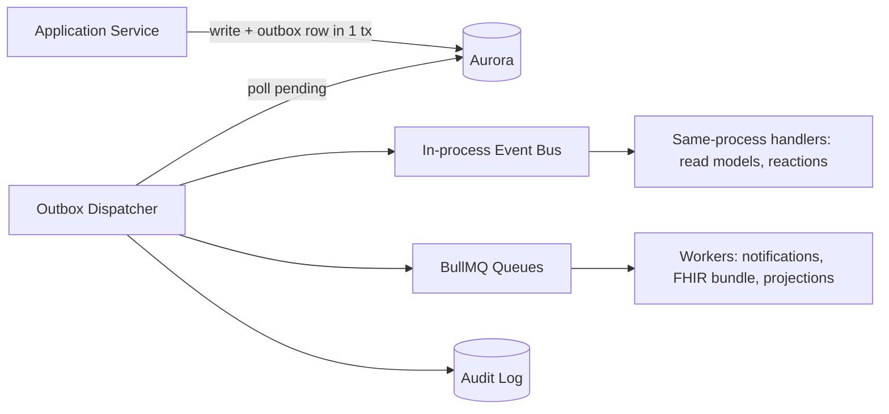

# AIIMS+ — Backend Architecture (Phase 4)

**Version:** 1.0 · **Owner:** Principal Engineer · **Status:** **Frozen (canonical, approved 2026-07-04)**
**Dependencies:** `../architecture/ARCHITECTURE-BLUEPRINT.md`, `../database/DATABASE-ARCHITECTURE.md`,
`../security/SECURITY-BLUEPRINT.md`, ADRs 0001–0011, DDRs 0001–0013, SDRs 0001–0013
**Last Updated:** 2026-07-04 · **Review Trigger:** GOVERNANCE.md §6 flaw process; new bounded context.

Canonical backend reference for AIIMS+. It **builds on** the frozen Architecture, Database, and Security
phases and does not redesign them. Backend-specific decisions are recorded as **BDRs** (`BDR-0001…`). A
consistency review is in §21 and the freeze report in §22. No implementation code.

**Inherited, non-negotiable (frozen):** modular monolith on Fargate (ADR 0001); NestJS + TypeScript;
Drizzle confined to `packages/db` (ADR 0011); Postgres RLS tenancy with `SET LOCAL` (DDR 0002); FHIR-
regenerable model (ADR 0003); transactional outbox + hash-chained audit (DDR 0007); operational-only AI
behind a port (Blueprint §10/§28); global authN/authZ/tenant/audit middleware (SDR-0001/0002/0003/0009).

---

## 1. Backend Principles

1. **Bounded contexts are the unit of modularity** — each is a NestJS module with an explicit public API.
2. **Layered, dependency-inward** — controllers → application services → domain → repository ports; the
   domain depends on nothing outward (ports & adapters).
3. **The database enforces isolation; the backend must never assume it can bypass RLS.**
4. **One transaction = one tenant, one business change + its outbox event + its audit** (atomicity).
5. **Integrations only through ports** with mock defaults + feature flags (ADR 0010).
6. **Contracts are shared truth** — API/event/domain types live in `packages/*`, not duplicated.
7. **Cross-cutting concerns are middleware, not per-handler code** (auth, tenant, validation, audit, errors).
8. **No PHI in logs, errors, or events beyond references** (SDR-0004/0010).

---

## 2. Module Boundaries (bounded contexts) — BDR-0002

Mirrors Blueprint §7 and the DB bounded-context schemas (DDR 0004). Each domain module owns its schema
and exposes a narrow interface; modules communicate **only** via that interface or **domain events**.

**Platform / cross-cutting modules:** `TenantContextModule`, `AuthModule`, `AuthzModule`, `AuditModule`,
`OutboxModule`, `EventBusModule`, `FeatureFlagModule`, `ConfigModule`, `ObservabilityModule`.

**Integration adapter modules (ports, mock default):** `AbdmAdapterModule`, `ConsentModule`,
`PaymentAdapterModule`, `NotificationAdapterModule`, `AiGatewayModule`.

**Domain modules (OPD Stage-1):** `PatientModule`, `SchedulingModule`, `EncounterModule`, `OrdersModule`,
`BillingModule` (+ future `PharmacyModule`, `LabModule`, `IpdModule`, `ReportingModule`).

**Hard rule (BDR-0002):** a module must not import another module's internal services or query another
module's tables. Cross-context needs are met by (a) calling the other module's **public interface**, or
(b) reacting to its **domain events**. Enforced by ESLint import-boundary rules + the schema grants (DDR 0004).

---

## 3. Package Structure & Dependency Rules — BDR-0001/0013

```
apps/api/                      # NestJS monolith
  src/
    modules/
      <context>/
        <context>.module.ts
        api/                   # controllers (thin) + DTOs bound to api-contracts
        application/           # application services (use-cases, orchestration, tx boundary)
        domain/                # entities/aggregates, value objects, domain services, domain events
        ports/                 # repository & gateway interfaces (owned by the domain)
        infrastructure/        # repository impls (delegate to packages/db), adapter impls
    platform/                  # tenant-context, auth, authz, audit, outbox, event-bus, config, otel
    main.ts
packages/
  domain-types/  api-contracts/  event-schemas/  authz/  config/  db/  ui/  testing/
```

**Dependency direction (inward only):**
`api → application → domain ← ports ← infrastructure`, and everything may depend on `packages/domain-types`.
- **Domain** depends on nothing outward (no NestJS, no Drizzle, no HTTP).
- **Ports** (interfaces) are defined in the domain; **infrastructure** implements them.
- **Drizzle** appears **only** in `packages/db` + a module's `infrastructure/` repository impl; ORM types
  never cross into `application`/`domain`/`api` (preserves ADR 0011 Prisma fallback).
- **Enforcement:** ESLint boundaries + Turborepo graph; violations fail CI.

---

## 4. Layered Responsibilities — BDR-0001

- **Controller (api/):** HTTP only — parse/validate input via `api-contracts` Zod, call one application
  service, map result/errors to the response envelope. No business logic.
- **Application service (application/):** the **use-case orchestrator** and **transaction boundary** (§6).
  Loads aggregates via repository ports, invokes domain logic, persists, emits domain events to the outbox.
  Holds no domain rules itself.
- **Domain (domain/):** aggregates/entities/value-objects enforce **invariants**; domain services hold
  logic spanning aggregates. Pure, testable, framework-free. Emits domain events.
- **Repository (ports/ + infrastructure/):** ports are domain interfaces; impls translate to Drizzle
  queries under the tenant context. Repositories return domain objects, not ORM rows.

This keeps business rules in the domain (no anemic model) and IO at the edges.

## 5. Repository Layer & Database Interaction — BDR-0003 (implements DDR 0002/0003/0011)

- **Ports in the domain, impls in `infrastructure/`** delegating to `packages/db` (Drizzle).
- **Every** repository call executes **within a tenant-context transaction** (§6) — the RLS `SET LOCAL
  app.tenant_id` is already set; repositories never open raw, context-less connections.
- Repositories expose intention-revealing methods (`findActiveByPractitioner`, `save`), not generic query
  builders, so query patterns stay reviewable and indexed (DB §12).
- **No ORM types leak.** Mapping row↔domain happens in `infrastructure/`.
- Read-side queries for projections/reporting use `aiims_readonly` + read replicas (§7 CQRS).

## 6. Transaction Boundaries & Unit of Work — BDR-0004 (implements DDR 0002/0007)

- **The application service is the transaction boundary.** One use-case = one DB transaction.
- At transaction start, the **tenant + actor context is set** (`SET LOCAL app.tenant_id`, `app.actor_id`)
  from the verified token (SDR-0001/0003) — RLS and audit both depend on it.
- Within the transaction: business writes **+** outbox event insert **+** (where applicable) audit insert
  commit **atomically** (transactional outbox, DDR 0007). No dual-write to external systems inside the tx.
- **Optimistic concurrency** (`version`, DDR 0009) guards mutable aggregates; conflicts → `409`.
- Long/slow work is **not** done in the request transaction — it is offloaded to jobs (§8) via the outbox.

## 7. Event Flow, Outbox Dispatch & CQRS Strategy — BDR-0005/0006 (implements DDR 0007)

**Event flow:**

- Domain events are written to the **outbox** in the business transaction; a **dispatcher** publishes them
  to the **in-process event bus** (synchronous, same-process reactions) and to **BullMQ** (async work), and
  appends to the **audit log**. Payloads conform to `packages/event-schemas` (versioned).
- **Delivery:** at-least-once; **consumers are idempotent** (dedupe on event id).

**CQRS strategy — CQRS-lite (BDR-0006):**
- **Commands** mutate through aggregates + repositories (§4–§6). **Not** event-sourced — Postgres remains
  the system of record.
- **Queries:** simple reads hit the transactional tables directly (tenant-scoped, indexed). **Expensive
  reads** (dashboards, worklists, search) use **read-model projections** built from domain events and
  served from read replicas (`aiims_readonly`).
- This gives read/write separation where it pays off without the complexity/consistency cost of full
  event sourcing. Projections are rebuildable by replaying the event stream.

## 8. Background Jobs & Scheduling — BDR-0007 (implements Blueprint §15)

- **BullMQ on Redis.** Job families: notifications, FHIR bundle generation, read-model projection updates,
  ABDM/consent async flows (mock in MVP), report generation, retention sweeps (Production).
- **Semantics:** at-least-once, **idempotent handlers**, exponential backoff, **dead-letter queues**,
  visibility via observability (§15). Scheduled/cron jobs via BullMQ repeatable jobs.
- **Tenant context in jobs:** the job payload carries `tenant_id`; the worker opens a tenant-context
  transaction (SET LOCAL) exactly like the API — **RLS applies to workers too** (SDR-0003).
- **Isolation:** workers run as separate Fargate services scaling independently (Blueprint §26).

## 9. Integrations (Ports & Adapters) — BDR-0008 (implements ADR 0010; ADR 0004/0006; SDR-0011)

- Every external system is reached through a **port (interface) in the domain**, with an **adapter impl**
  in `infrastructure/` selected by **feature flag**; the **default is a mock**.
- Ports: `ConsentProvider` (ADR 0004), `AbdmGateway` (ADR 0006), `PaymentGateway`, `NotificationSender`,
  `AiGateway` (SDR-0011). MVP ships mocks that make the full experience demoable with no external dependency.
- Adapters own: protocol, retries/timeouts, PHI redaction before egress (SDR-0004/0011), and mapping
  (e.g. domain→FHIR at the ABDM adapter, ADR 0003).
- **No module calls an external system directly** — always via its port. Swapping mock→real is a config change.

## 10. Shared Libraries (`packages/*`) — BDR-0001

- `domain-types` — FHIR-aligned domain types + Zod schemas (source of truth; imported everywhere).
- `api-contracts` — request/response + error-envelope contracts; drive the typed client and validation.
- `event-schemas` — versioned outbox event payloads.
- `authz` — RBAC policy model + PDP helpers (SDR-0002).
- `config` — typed config + feature-flag client (BDR-0011).
- `db` — Drizzle schema, RLS policy migrations, tenant-context helper (the only Drizzle home).
- `testing` — test utilities incl. the **cross-tenant isolation harness** (DDR/DB §17).
Dependency rule: packages depend inward toward `domain-types`; none depends on an app.

## 11. Validation Strategy — BDR-0009

Layered, defense-in-depth (no single point of trust):
1. **Edge/API:** Zod validation from `api-contracts` — shape, types, ranges; reject-by-default. Same schema
   shared with the frontend.
2. **Domain:** aggregates enforce **business invariants** (state transitions, cross-field rules) — the
   authoritative check; cannot be bypassed by a different caller.
3. **Database:** constraints (NOT NULL, FK, CHECK, unique, exclusion) as the final backstop (DDR 0008/0009).
Coded values validated against `reference` code systems (DDR 0012).

## 12. Error Handling — BDR-0010

- **Error taxonomy:** `DomainError` (invariant/business rule), `ApplicationError` (use-case/authorization/
  not-found/conflict), `IntegrationError` (adapter/external), `InfrastructureError` (DB/infra). Domain and
  application errors are typed; infra errors are wrapped.
- **Global exception filter** maps errors → the consistent **response envelope** with a stable error code;
  **never leaks PHI, secrets, or stack traces** (SDR-0009/0010). 5xx are logged with a correlation id only.
- **Concurrency conflicts → 409**; validation → 422; authz → 403; not-found → 404; integration/mock failures
  degrade gracefully (AI/notifications off the critical path).

## 13. Configuration Management — BDR-0011

- **Typed config** (`packages/config`): all config parsed and **validated at boot via Zod**; the app
  fails fast on missing/invalid config.
- **Secrets** never in config files/images — injected from AWS Secrets Manager at runtime (SDR-0006).
- **Feature flags** (`FeatureFlagModule`) gate mock↔real integrations and dark-launch Production features
  (ADR 0010); flags resolvable per tenant (DB §5).
- **Per-environment** config (dev/staging/prod) isolated; no prod secrets outside prod.

## 14. Security Integration (how the backend enforces the Security Blueprint)

The backend realizes the Security controls as ordered cross-cutting middleware (§15), not per-handler code:
- **AuthN** (SDR-0001): OIDC token verification guard; rejects invalid/expired tokens.
- **Tenant context** (SDR-0003): sets `SET LOCAL app.tenant_id/actor_id` per request transaction — the
  linchpin for RLS and audit.
- **AuthZ** (SDR-0002): PEP guard calls the `authz` PDP (RBAC; ABAC/consent-aware ready).
- **Validation** (SDR-0009): Zod at the edge.
- **Audit** (SDR-0007): audit events emitted via the outbox for security-relevant actions.
- **Redaction** (SDR-0004/0010): PHI stripped before logs/AI egress.
- **Errors** (SDR-0009): envelope with no PHI/stack leakage.
Workers apply the same tenant-context + audit discipline (§8).

## 15. Observability Hooks & Middleware Order — BDR-0012

**Request pipeline (NestJS):**
```
Request → AuthN guard → Tenant-context (tx + SET LOCAL) → AuthZ guard (PDP)
        → Validation (Zod) → Controller → Application service (domain + repo + outbox)
        → Commit → Audit emit (via outbox) → Response mapper
        → [on error] Global exception filter (envelope, no PHI)
```
- **OpenTelemetry** traces span API → application → repository → workers → AI plane; **structured JSON logs**
  carry correlation + tenant + actor ids (no PHI, SDR-0010); RED metrics per endpoint/queue.
- **Health/readiness** probes per service; security signals (authz denials, isolation anomalies, audit-
  integrity failures) are first-class (SDR-0010).

## 16. MVP vs Production (backend)

| Concern | MVP | Production |
|---|---|---|
| Integrations | Mock adapters (ABDM/consent/pay/notify/AI) | Real, via same ports |
| CQRS | Direct reads + a few projections | More read models, replicas |
| Jobs | Core BullMQ families | Retention sweeps, ABDM async, SIEM feeds |
| AI plane | Port + stub/flag | Real Python plane |
| Authz | RBAC | + ABAC/consent-aware/break-glass |

## 17. Risks & Mitigations (backend)

| ID | Risk | Severity | Mitigation |
|---|---|---|---|
| B-1 | A code path opens a DB connection without tenant context → RLS fails closed but breaks the feature | High | Single tenant-context tx wrapper; lint/review; isolation gate |
| B-2 | ORM types leak into domain, defeating the Prisma fallback | Medium | Import-boundary lint; repositories return domain objects |
| B-3 | Module boundary erosion (direct cross-module table access) | High | ESLint boundaries + per-schema grants (DDR 0004) |
| B-4 | Non-idempotent event/job handlers cause double effects | Medium | Idempotency keys + dedupe on event id |
| B-5 | Business logic leaking into controllers/services (anemic domain) | Medium | Layer rules (§4); domain owns invariants |
| B-6 | Long work in request tx harms latency/locks | Medium | Offload to jobs via outbox (§6/§8) |
| B-7 | PHI in logs/events/errors | High | Redaction + no-PHI lint + envelope (SDR-0004/0010) |

## 18. Testing Hooks (backend)

- **Cross-tenant isolation suite** (DB §17) is the merge-blocking backstop, run under `aiims_app`.
- **Unit:** pure domain tests (no IO). **Integration:** application service + repository against a real
  Postgres with RLS. **Contract:** api-contracts + event-schemas verified. **Idempotency** tests for
  handlers. Full detail is the **Testing phase (TDR)**; this section only fixes the hooks.

## 19. Interaction with Database Architecture (summary)

Backend consumes the DB architecture exactly as frozen: tenant-context tx + RLS (DDR 0002/0003), repository
over Drizzle in `packages/db` (DDR 0011), outbox+audit atomicity (DDR 0007), optimistic concurrency + slot
exclusion (DDR 0009), coded concepts via `reference` (DDR 0012), retention/soft-delete fields (DDR 0013).
No schema change is introduced by the backend design.

## 20. Interaction with Security Architecture (summary)

Backend realizes SDR-0001 (auth), 0002 (authz PEP/PDP), 0003 (tenant isolation in API + workers), 0004
(PHI redaction/field-encryption use), 0007 (audit emit), 0009 (API controls), 0010 (logging redaction),
0011 (AI gateway boundary). No security control is weakened; all are enforced as middleware/ports.

## 21. Backend Consistency Review (vs frozen foundation)

| Frozen source | Backend position | Consistent? |
|---|---|---|
| ADR 0001 (modular monolith) | §2 NestJS modules, single deployable, workers as services | ✅ |
| ADR 0010 (build once, integrate later) | §9 ports + mock default + flags | ✅ |
| ADR 0011 (Drizzle confined) | §3/§5 ORM only in `packages/db` + infra; no leak | ✅ |
| DDR 0002/0003 (RLS, roles, SET LOCAL) | §6 tenant-context tx; §8 workers too | ✅ |
| DDR 0007 (outbox + audit atomicity) | §6/§7 one-tx write+event+audit | ✅ |
| DDR 0009 (optimistic concurrency) | §6 version checks → 409 | ✅ |
| DDR 0004 (bounded-context schemas) | §2 module = schema ownership; no cross access | ✅ |
| ADR 0003 (FHIR facade) | §9 mapping in ABDM adapter | ✅ |
| SDR-0001/0002/0003/0009/0010 | §14/§15 ordered middleware pipeline | ✅ |
| SDR-0004/0011 (redaction, AI boundary) | §9/§12/§14 redaction before egress; AI via port | ✅ |
| Blueprint §10/§28 (operational AI) | §9 `AiGateway` port, no clinical write path | ✅ |

**Result: no contradictions, no critical flaws.** The backend design is a faithful realization of the
frozen Architecture, Database, and Security phases; it introduces no schema or security change and reopens
no prior decision.

## 22. Backend Freeze Report

**Defined & authoritative:**
- [x] Module boundaries + communication rules (§2) — BDR-0002
- [x] Package structure + dependency rules (§3) — BDR-0001/0013
- [x] Layered responsibilities: domain/application/repository (§4) — BDR-0001
- [x] Repository layer + DB interaction (§5) — BDR-0003
- [x] Transaction boundaries / unit of work (§6) — BDR-0004
- [x] Event flow, outbox dispatch, CQRS-lite (§7) — BDR-0005/0006
- [x] Background jobs + scheduling (§8) — BDR-0007
- [x] Integrations (ports & adapters) (§9) — BDR-0008
- [x] Shared libraries (§10), validation (§11) — BDR-0009, error handling (§12) — BDR-0010
- [x] Configuration (§13) — BDR-0011, security integration (§14), observability + middleware order (§15) — BDR-0012
- [x] MVP/Prod split, risks, testing hooks, DB & Security interaction (§16–§20)
- [x] Consistency review (§21) — no contradictions

**Deferred to later phases (non-blocking):**
- [ ] Concrete API contracts, endpoints, versioning detail → **API phase (APDR)**
- [ ] Detailed test strategy/coverage → **Testing phase (TDR)**
- [ ] Real integration wiring (ABDM/consent/pay/notify/AI) → Production
- [ ] CI/build/deploy specifics → **Infrastructure/Deployment phases (IDR/ODR)**

**Freeze status: READY TO FREEZE** on approval. The backend architecture is internally consistent with
all frozen phases and safe for the API, AI, Testing, and Infrastructure phases to build upon.

*End of Backend Architecture v1.0.*

