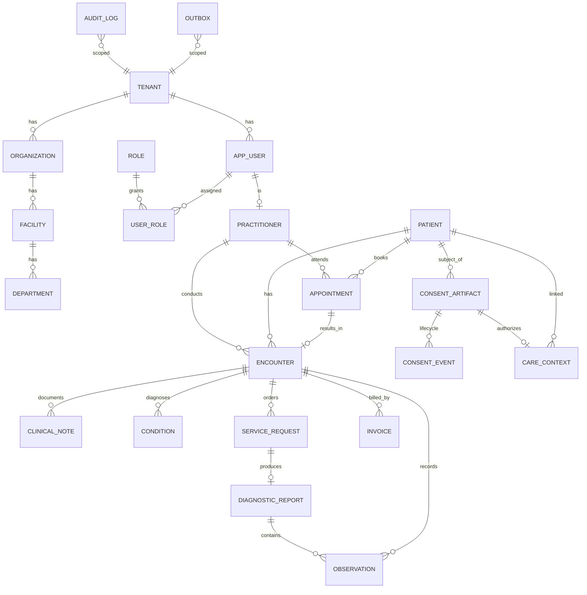

# AIIMS+ — Database Architecture (Phase 2)

**Version:** 1.0 · **Date:** 2026-07-04 · **Phase:** 2 (Database Architecture)
**Owner:** Database Architect · **Status:** Frozen · **Dependencies:** ../architecture/ARCHITECTURE-BLUEPRINT.md, ../adr/ (ADR-0002/0003/0009/0011), ../ddr/
**Last Updated:** 2026-07-04 · **Review Trigger:** GOVERNANCE.md §6 flaw process only
**Foundation:** `../architecture/ARCHITECTURE-BLUEPRINT.md` v1.1 (Frozen-core) + ADRs 0001–0011.
**Scope of this document:** the complete database architecture — engine topology, multi-tenancy/RLS,
role & connection model, conventions, type standards, platform + audit/outbox + consent tables, the
**OPD Stage-1 domain schema**, FHIR-regeneration mapping, PHI encryption, indexing, partitioning,
migrations, concurrency, retention, and the isolation-test harness.

**Governing constraints inherited from Phase 1 (not revisited):**
- Engine: **PostgreSQL on Aurora** (§3, ADR 0002/0003).
- ORM: **Drizzle**, confined to `packages/db`; repositories expose interfaces (ADR 0011).
- Tenancy: **RLS-enforced**, promotable to dedicated DB (ADR 0002).
- Clinical model: **relational core + FHIR-R4-regenerable** (ADR 0003).
- Audit: **append-only, hash-chained, outbox-fed** (ADR 0005).
- Retention: **per-record keys + retention metadata now; engine later** (ADR 0009).
- Phase rule: structure now, integrate later (ADR 0010).

> **Conflict-watch:** per the Phase-2 mandate, architecture decisions are not reopened unless the
> database forces it. **One clarification is raised, not a conflict** — see §16 (PHI encryption vs
> queryability) and §19 Open Questions. Nothing here contradicts the frozen core.

---

## 1. Database Architecture Principles

1. **The database is the last line of defense for tenant isolation** — RLS is mandatory and `FORCE`d;
   the app role can never see across tenants even with a buggy query.
2. **Integrity over convenience** — foreign keys, `NOT NULL`, `CHECK` constraints, and enums are used
   liberally; the schema is the authoritative model (Master Ch. 6).
3. **Every clinical table is FHIR-regenerable** — hot fields are promoted to columns; the rest lives in a
   typed `fhir_extensions jsonb`; stable identifiers are first-class.
4. **Append-only where truth must be preserved** — audit and outbox are insert-only; clinical records are
   versioned/amended, never silently mutated.
5. **PHI is encryptable and shreddable** — direct identifiers are field-encrypted with per-record keys to
   enable crypto-shredding (ADR 0009) without destroying operational queryability.
6. **Design for the promotion path** — nothing assumes a shared cluster; a tenant can move to a dedicated
   database with no schema change.
7. **Indexes lead with `tenant_id`** — every tenant-scoped access pattern is a composite index.
8. **Migrations are explicit and reviewed** — especially RLS policies (Drizzle guardrail, ADR 0011).

---

## 2. Cluster Topology (from ADR 0001/0007, not reopened)

- **Amazon Aurora PostgreSQL**, **Multi-AZ** writer + reader in `ap-south-1`.
- **Read replica(s)** for read-heavy paths (dashboards, search projections, reporting).
- **RDS Proxy** in front for connection pooling and failover resilience.
- **DR:** automated backups + PITR; snapshot copy to `ap-south-2` (numbers deferred to ops ADR, §19).
- **Version target:** Aurora PostgreSQL tracking PG 16+; adopt PG 18 features (native `uuidv7()`) only
  once Aurora GA's them — until then IDs are app-generated (§4).

**Pooling caveat (design note):** tenant context is set with `SET LOCAL` **inside a transaction**
(§3), which is safe under RDS Proxy/transaction pooling. Session-level GUCs are never used for tenant
context, because pooled connections are shared.

---

## 3. Multi-Tenancy & Row-Level Security (implements ADR 0002)

### Column contract
Every tenant-scoped table carries:
```
tenant_id  uuid  NOT NULL   -- FK → platform.tenant(id)
```
Global/reference tables (code systems, country data) are **not** tenant-scoped and are read-only to the
app role.

### RLS policy pattern (per tenant-scoped table)
```sql
ALTER TABLE <t> ENABLE ROW LEVEL SECURITY;
ALTER TABLE <t> FORCE ROW LEVEL SECURITY;         -- applies even to table owner
CREATE POLICY tenant_isolation ON <t>
  USING      (tenant_id = current_setting('app.tenant_id', true)::uuid)
  WITH CHECK (tenant_id = current_setting('app.tenant_id', true)::uuid);
```
- `USING` filters reads/updates/deletes; `WITH CHECK` blocks writing another tenant's `tenant_id`.
- `current_setting('app.tenant_id', true)` returns NULL if unset → policy denies all rows (fail-closed).

### Setting tenant context
`TenantContextModule` (blueprint §7) opens a transaction and runs:
```sql
SET LOCAL app.tenant_id = '<uuid-from-verified-token>';
SET LOCAL app.actor_id  = '<user-uuid>';   -- for audit
SET LOCAL app.role      = '<role>';        -- optional, for policy refinement
```
No data access occurs outside a transaction that has set `app.tenant_id`.

### Postgres role model (critical)
| Role | Purpose | RLS |
|---|---|---|
| `aiims_owner` | Owns schema objects; used **only** by migrations. | Subject to FORCE RLS too, but migrations set a bypass context. |
| `aiims_migrator` | Runs DDL / RLS-policy migrations in CI. | N/A (DDL). |
| `aiims_app` | The application runtime role. **Not** owner, **not** superuser, **no** `BYPASSRLS`. | **Always enforced.** |
| `aiims_readonly` | Analytics/replica reads. | Enforced. |

Because `aiims_app` is neither owner nor `BYPASSRLS`, a forgotten `WHERE tenant_id` **cannot** leak data
— the policy still filters. This is the core PHI safeguard.

### Dedicated-DB promotion
Promotion moves a tenant's rows to a dedicated database; the tenant registry (platform) maps
`tenant_id → connection`. Because every table already carries `tenant_id` and RLS, **no schema change**
is needed — the same code path, a different connection.

---

## 4. Conventions & Type Standards

- **Primary keys:** `id uuid` = **UUIDv7, application-generated** (time-ordered → index-friendly,
  non-enumerable, safe across the dedicated-DB promotion, available pre-insert for outbox correlation).
  Migrate to native `uuidv7()` once Aurora GAs PG 18. *Rejected:* `bigserial` (leaks counts, collides on
  promotion/merge), UUIDv4 (index fragmentation).
- **Timestamps:** `timestamptz` always, UTC; `created_at`, `updated_at` on every row.
- **Money:** `numeric(14,2)` + ISO-4217 `currency char(3)`; never floating point.
- **Enums:** Postgres `ENUM` for stable small sets (status fields); **lookup tables** for extensible /
  coded sets (departments, code systems).
- **Coded concepts (FHIR CodeableConcept):** promoted columns `*_system`, `*_code`, `*_display` for the
  primary coding + `*_codings jsonb` for the full array. Code systems (ICD-10, SNOMED CT, LOINC) are
  seeded reference tables.
- **Booleans:** explicit; avoid nullable booleans.
- **Naming:** `snake_case`; tables **singular** (`patient`, `encounter`); FKs `<referenced>_id`; indexes
  `ix_<table>__<cols>`; unique `uq_…`; checks `ck_…`; policies `tenant_isolation`.
- **Schemas (Postgres):** bounded-context schemas — `platform`, `clinical`, `orders`, `billing`,
  `consent`, `audit`, `reference`. Keeps ownership boundaries visible; RLS is per-table regardless.
  *Trade-off:* multi-schema adds minor Drizzle config overhead vs one flat schema — accepted for clarity
  and to mirror module boundaries (blueprint §7).
- **Every mutable aggregate** has `version int NOT NULL DEFAULT 0` (optimistic concurrency, §17) and
  soft-delete/retention columns (§18).

### Standard column mixins
```
-- base:      id uuid PK, created_at, updated_at, version int
-- tenant:    tenant_id uuid NOT NULL  (+ RLS)
-- soft/ret:  deleted_at timestamptz NULL, retention_class text NULL, retention_until timestamptz NULL
-- fhir:      fhir_id text, identifiers jsonb, fhir_extensions jsonb
-- crypto:    enc_key_ref text NULL   (per-record data-key reference; §16)
```

---

## 5. Platform Schema (tenancy, org structure, identity mapping, feature flags)

`platform` holds the tenant registry and org hierarchy. `platform.tenant` is the isolation root and is
**not** itself RLS-filtered by `app.tenant_id` (it is the lookup that resolves tenancy); access to it is
restricted to platform/admin operations.

| Table | Key columns | Notes |
|---|---|---|
| `platform.tenant` | `id`, `slug uq`, `name`, `status`, `isolation_mode` (`shared`\|`dedicated`), `region` | Isolation root; drives promotion routing. Not tenant-RLS'd. |
| `platform.organization` | `id`, `tenant_id`, `name`, `type` (hospital/clinic/chain) | RLS'd. A tenant may hold ≥1 org. |
| `platform.facility` | `id`, `tenant_id`, `organization_id`, `name`, `address jsonb`, `timezone` | Physical site. |
| `platform.department` | `id`, `tenant_id`, `facility_id`, `name`, `code` | e.g. OPD-General, OPD-Cardio. |
| `platform.app_user` | `id`, `tenant_id`, `keycloak_sub uq`, `display_name`, `status` | **Maps** the Keycloak subject → tenant user. No passwords (Keycloak owns auth, ADR 0008). |
| `platform.role` | `id`, `tenant_id`, `code`, `name` | RBAC roles (doctor, nurse, front_desk, admin). |
| `platform.user_role` | `tenant_id`, `user_id`, `role_id`, `department_id?` | Role assignments, optionally department-scoped. |
| `platform.feature_flag` | `id`, `tenant_id?`, `key`, `enabled`, `variant jsonb` | Null tenant = global default; per-tenant override (blueprint §7). |

Referential integrity is **tenant-scoped**: composite FKs `(tenant_id, <parent_id>)` so a child can never
reference a parent in another tenant. Example: `facility(tenant_id, organization_id) → organization(tenant_id, id)`.

---

## 6. Audit & Outbox Schema (implements ADR 0005 / blueprint §14, §21)

### `platform.outbox` (transactional outbox)
| Column | Type | Notes |
|---|---|---|
| `id` | uuid (v7) | Event id; generated with the business write. |
| `tenant_id` | uuid | RLS'd. |
| `aggregate_type` / `aggregate_id` | text / uuid | Source entity. |
| `event_type` | text | Versioned, e.g. `patient.registered.v1`. |
| `payload` | jsonb | Matches `packages/event-schemas`. **No raw PHI** beyond references/minimal fields. |
| `occurred_at` | timestamptz | |
| `dispatched_at` | timestamptz NULL | Null = pending. |
| `dispatch_attempts` | int | For retry/backoff. |

Written in the **same transaction** as the business change (guarantees no lost/orphan events). A
dispatcher reads pending rows → in-process bus + BullMQ + audit. Partitioned by month (§15-partitioning).

### `audit.audit_log` (append-only, hash-chained)
| Column | Type | Notes |
|---|---|---|
| `id` | uuid (v7) | |
| `tenant_id` | uuid | RLS'd. |
| `actor_id` | uuid | From `app.actor_id`. |
| `action` | text | e.g. `encounter.read`, `patient.update`. |
| `resource_type` / `resource_id` | text / uuid | Target. |
| `occurred_at` | timestamptz | |
| `consent_ref` | uuid NULL | Link to `consent.consent_artifact` (why the access was lawful). |
| `context` | jsonb | Source IP, request id, outcome — **no PHI payloads**. |
| `prev_hash` / `row_hash` | bytea | Hash chain: `row_hash = H(prev_hash ‖ canonical(row))`. |

**Immutability enforcement:**
```sql
REVOKE UPDATE, DELETE ON audit.audit_log FROM aiims_app;   -- insert-only for the app
```
Tampering is detectable via the chain; a scheduled verifier re-walks it (Production, blueprint §21).
Partitioned monthly; archived to S3 Object Lock (WORM) in Production.

---

## 7. Consent Schema (implements ADR 0004 — regime-agnostic)

`consent` models the **generic** artifact; ABDM/DPDP specifics attach via adapters (blueprint §10 ports).

| Table | Key columns | Notes |
|---|---|---|
| `consent.consent_artifact` | `id`, `tenant_id`, `subject_patient_id`, `purpose` (`self`/`treatment`/`payment`/`research`), `scope jsonb` (HI types, resources), `regime` (`data_sharing`/`data_processing`), `provider` (`mock`/`abdm`/`dpdp`), `status` (`requested`/`granted`/`expired`/`revoked`), `valid_from`, `valid_to`, `version`, `provenance jsonb` | Immutable once `granted`; state transitions append events. |
| `consent.consent_event` | `id`, `tenant_id`, `artifact_id`, `event` (`grant`/`withdraw`/`expire`), `occurred_at`, `actor_id` | Full lifecycle trail. |

Enforcement (blueprint §7): no data-sharing/processing path proceeds without a valid, unexpired artifact
resolved here; every check is audited with `consent_ref`. In **MVP** the `provider = mock` implementation
issues/validates locally; real ABDM/DPDP wiring is Production — **no schema change** to switch.

---

## 8. OPD Clinical Domain Schema (Stage-1 hero flow)

Schemas `clinical` and `orders`. Every table uses the tenant + fhir + soft/ret mixins (§4) and RLS (§3).
Column lists below are the **hot promoted fields**; full FHIR fidelity is regenerated from these + JSONB.

### `clinical.patient` → FHIR **Patient**
`id`, `tenant_id`, `mrn` (tenant-unique medical record no.), `abha_number enc`, `abha_address`,
`name_given`, `name_family`, `gender`, `birth_date`, `phone enc`, `email enc`, `address jsonb`,
`identifiers jsonb` (ABHA/Aadhaar refs), `fhir_extensions jsonb`, `enc_key_ref`, `deleted_at`,
`retention_class`, `retention_until`, `version`.
*Direct identifiers (`abha_number`, `phone`, `email`) are field-encrypted (§16). `mrn` unique per tenant:
`uq_patient__tenant_mrn (tenant_id, mrn)`.*

### `clinical.practitioner` → FHIR **Practitioner** / **PractitionerRole**
`id`, `tenant_id`, `app_user_id`, `name_*`, `registration_no` (medical council), `specialty_codings jsonb`,
`department_id`, `fhir_extensions`. Links a clinician to their platform user + department.

### `clinical.appointment` → FHIR **Appointment** / uses **Schedule/Slot** (Scheduling module)
`id`, `tenant_id`, `patient_id`, `practitioner_id`, `department_id`, `start_at`, `end_at`,
`status` (`booked`/`arrived`/`fulfilled`/`cancelled`/`noshow`), `reason_text`, `version`.
Indexes: `(tenant_id, practitioner_id, start_at)`, `(tenant_id, patient_id, start_at)`, partial on active
statuses.

### `clinical.encounter` → FHIR **Encounter**
`id`, `tenant_id`, `patient_id`, `practitioner_id`, `appointment_id?`, `department_id`,
`class` (`outpatient`), `status` (`planned`/`in-progress`/`finished`/`cancelled`), `period_start`,
`period_end`, `fhir_extensions`, `version`. The OPD visit spine.

### `clinical.clinical_note` (documentation) → FHIR **DocumentReference** / **Composition**
`id`, `tenant_id`, `encounter_id`, `patient_id`, `author_practitioner_id`, `note_type`, `text_ref`
(pointer to S3 object for large text; small text inline `body`), `status` (`draft`/`final`/`amended`),
`version`, `signed_at`, `signed_by`. **Amendments create a new version**, prior versions retained
(medico-legal). *Constitution: authored/edited/signed by the clinician; AI may draft, never sign.*

### `clinical.observation` → FHIR **Observation** (vitals, measurements)
`id`, `tenant_id`, `encounter_id`, `patient_id`, `code_system`, `code`, `code_display` (e.g. LOINC),
`value_num`, `value_unit`, `value_codings jsonb`, `effective_at`, `status`, `fhir_extensions`.
High-volume → partitioning candidate (§15).

### `clinical.condition` → FHIR **Condition** (diagnosis/problem)
`id`, `tenant_id`, `encounter_id`, `patient_id`, `code_system`, `code`, `code_display` (ICD-10/SNOMED),
`clinical_status`, `onset_at`, `recorded_at`, `recorder_practitioner_id`, `fhir_extensions`.
*Recorded by the clinician; never AI-authored.*

### `orders.service_request` → FHIR **ServiceRequest** (lab/radiology order)
`id`, `tenant_id`, `encounter_id`, `patient_id`, `requester_practitioner_id`, `category` (`lab`/`imaging`),
`code_system`, `code`, `code_display`, `priority`, `status` (`draft`/`active`/`completed`/`revoked`),
`requested_at`, `fhir_extensions`.

### `orders.diagnostic_report` → FHIR **DiagnosticReport** (results)
`id`, `tenant_id`, `service_request_id`, `patient_id`, `status`, `issued_at`, `conclusion`,
`result_observation_ids uuid[]` (or link table), `presented_form_ref` (S3 PDF/object), `fhir_extensions`.

### `billing.invoice` → (FHIR **Invoice** optional) 
`id`, `tenant_id`, `patient_id`, `encounter_id`, `status` (`draft`/`issued`/`paid`/`void`),
`currency char(3)`, `total numeric(14,2)`, `payment_ref` (via payment **adapter**, mocked in MVP),
`version`. Line items in `billing.invoice_line`.

### Care-context / ABDM linkage (structural, mock-driven in MVP)
`clinical.care_context` → `id`, `tenant_id`, `patient_id`, `encounter_id`, `abha_address`,
`reference`, `display`, `linked_at`, `consent_ref`. Populated by the ABDM adapter (mock in MVP) to make
records discoverable/shareable on consent — the ADR 0006 M2/M3 flow, demoable without real ABDM.

---

## 9. OPD Entity-Relationship Diagram


*All entities except `TENANT` and `REFERENCE` code systems carry `tenant_id` and are RLS-enforced.*

---

## 10. FHIR Regeneration Mapping (implements ADR 0003)

The mapping layer (in the ABDM adapter, blueprint §27) turns core rows into FHIR R4 India-profile
resources on demand. It never becomes the OLTP store.

| Core table | FHIR R4 resource | Identifier strategy |
|---|---|---|
| `clinical.patient` | Patient | `identifiers jsonb` carries ABHA (`https://healthid.abdm.gov.in`) + MRN; `fhir_id` stable. |
| `clinical.practitioner` | Practitioner (+ PractitionerRole) | Medical-council registration as identifier. |
| `clinical.appointment` | Appointment | Slot/Schedule synthesized from department + practitioner. |
| `clinical.encounter` | Encounter | `class = AMB` (outpatient). |
| `clinical.clinical_note` | DocumentReference / Composition | `text_ref` → attachment; status maps draft/final/amended. |
| `clinical.observation` | Observation | LOINC codings; value[x] from `value_num`/`value_unit`/`value_codings`. |
| `clinical.condition` | Condition | ICD-10/SNOMED codings; clinical-status map. |
| `orders.service_request` | ServiceRequest | category lab/imaging. |
| `orders.diagnostic_report` | DiagnosticReport | links Observations + `presented_form` (S3). |
| `consent.consent_artifact` | Consent | purpose/scope/validity map to ABDM consent artifact. |

**Fidelity rule:** any FHIR-required field for the India profiles that is not a promoted column **must**
be representable in `fhir_extensions jsonb`, and the mapping is **conformance-tested** against NHA
validators (Production). Reviewing the required India profiles up front (Database-phase task) prevents
"missing field ⇒ schema change" churn.

---

## 11. Reference Data Schema (`reference`, global, read-only to app)

Seeded, non-tenant code systems: `reference.code_system` (ICD-10, SNOMED CT, LOINC, ABDM value sets),
`reference.code` (`system`, `code`, `display`, `active`). Versioned by `release`. App role has SELECT
only. Keeps coded concepts consistent and FHIR-valid across tenants.

---

## 12. Indexing Strategy

- **Tenant-first composites** for every access pattern: `ix_encounter__tenant_patient (tenant_id, patient_id)`,
  `ix_appointment__tenant_pract_start (tenant_id, practitioner_id, start_at)`, etc.
- **Partial indexes** for hot status filters: e.g. active appointments
  `WHERE status IN ('booked','arrived')`.
- **GIN** on `jsonb` (`identifiers`, `fhir_extensions`, `value_codings`) and on `tsvector` for patient
  search (`pg_trgm` for fuzzy name/MRN) — feeds blueprint §17 (Postgres FTS in MVP).
- **Foreign-key indexes** on all `_id` columns (Postgres does not auto-index FKs).
- **Unique constraints** are tenant-scoped: `(tenant_id, mrn)`, `(tenant_id, code)` for departments/roles.
- **Covering indexes** where read models need them (added when the read pattern is proven, not preemptively).
- RLS adds `tenant_id = …` to every query, so leading with `tenant_id` keeps the planner efficient.

---

## 13. PHI Encryption & Crypto-Shred Readiness (implements ADR 0009)

**Design principle — encrypt identifiers, not everything.** Field-encrypting all clinical data would
destroy queryability, search, and indexing. So:
- **Field-encrypted (per-record key):** direct identifiers — `abha_number`, `phone`, `email`, and any
  Aadhaar reference. Stored as ciphertext; `enc_key_ref` points to a per-record/per-subject **data key**
  wrapped by a KMS CMK (envelope encryption). Destroying the data key crypto-shreds the record (erasure
  right) without racing physical deletion.
- **At-rest only (Aurora KMS):** all other columns rely on Aurora storage encryption + RLS. They remain
  queryable/indexable.
- **Deterministic vs randomized:** identifiers that must be *searched by exact value* (e.g. ABHA lookup)
  use a **blind index** (keyed HMAC in a separate `*_bidx` column) rather than decrypting at query time.
- **MVP scope (Structural Foundation):** the columns (`enc_key_ref`, `*_bidx`), the key-reference model,
  and envelope-encryption helper exist now; the full retention/crypto-shred **engine** and the legal
  durations are Production (ADR 0009). Encryption of the identifier set can be enabled from day one.

**Key management:** data keys via AWS KMS (GenerateDataKey), CMK in `ap-south-1`; keys never leave KMS in
plaintext beyond in-memory use. Rotation and per-tenant CMKs for dedicated tenants are Production options.

---

## 14. Concurrency & Consistency

- **Optimistic concurrency:** `version int` on mutable aggregates; updates use
  `WHERE id = ? AND version = ?` and bump `version`; a 0-row update ⇒ `409 Conflict`.
- **Transactions:** business write + outbox insert (+ audit) commit atomically. Serializable isolation
  only where invariants demand it (e.g. slot double-booking); default `READ COMMITTED` otherwise.
- **Double-booking guard:** appointment slots protected by an exclusion/unique constraint on
  `(tenant_id, practitioner_id, tstzrange(start_at, end_at))` via `btree_gist`.
- **No cross-tenant transactions** — a transaction operates under exactly one `app.tenant_id`.

---

## 15. Partitioning & Growth

- **`audit.audit_log` and `platform.outbox`:** **range-partitioned by month** from day one (high insert
  volume, time-scoped reads, cheap archival/drop of old partitions to WORM).
- **`clinical.observation`** (and later results/notes): partitioning candidate — **by month** or by
  **tenant hash** for very large tenants; designed-for now, enabled when volume warrants (not premature).
- **Dedicated-tenant promotion** (ADR 0002) is the other horizontal lever for the largest tenants.
- Read-heavy analytics run against **Aurora read replicas** and event-fed read models (blueprint §26),
  keeping OLTP tables lean.

---

## 16. Migrations & Schema Governance (Drizzle guardrails, ADR 0011)

- **Drizzle schema** lives in `packages/db`; `drizzle-kit` generates table migrations.
- **RLS policies, roles, GRANT/REVOKE, partitions, and `FORCE ROW LEVEL SECURITY` are hand-written,
  reviewed SQL migrations** — `drizzle-kit` is configured to **not** manage roles/RLS (prevents the
  silent-policy-drop footgun). A CI check diffs policies and **fails on any unexpected policy removal**.
- Migrations run as `aiims_migrator`; the app runs as `aiims_app` (no BYPASSRLS).
- **Expand/contract** pattern for zero-downtime (blueprint: hospitals are 24/7): add nullable → backfill →
  switch → drop, never a blocking rewrite in one step.
- Every migration is forward-only in prod, reviewed, and paired with a rollback plan.

---

## 17. The Cross-Tenant Isolation Test Harness (mandatory CI gate — ADR 0002/0011)

The permanent backstop. In `packages/testing`:
1. Seed two tenants (A, B) with overlapping data shapes.
2. Under `app.tenant_id = A`, attempt every access pattern against B's rows (select/update/delete, direct
   id, join, jsonb path, search) → **must return 0 rows / raise**, never leak.
3. Attempt to insert a row with B's `tenant_id` under A → **WITH CHECK must reject**.
4. Run with the **`aiims_app` role** (not owner) so `FORCE RLS` is exercised as in production.
5. A test that *removes* a policy must make the suite fail (validates the guardrail).

**This gate blocks merge.** It is the single most important test in the repository.

---

## 18. Soft Delete, Retention & Temporal History

- **Soft delete:** `deleted_at` (nullable); default queries exclude soft-deleted rows via repository
  convention. Hard delete only through the retention engine (Production).
- **Retention metadata:** `retention_class`, `retention_until` per record (values set once legal durations
  land — ADR 0009); the fields ship now.
- **Clinical amendments:** notes/conditions are **versioned** — an amendment writes a new version with
  status `amended` and preserves prior versions (medico-legal). MVP keeps in-row `version` + full audit
  trail; dedicated **history tables** (or event-sourced projections) are a Production enhancement.

---

## 19. Open Questions (Database-phase; non-blocking, tracked)

1. **India FHIR profile field audit** — enumerate required NDHM/ABDM Patient/Encounter/Observation fields
   to finalize which go to columns vs `fhir_extensions`. Owner: DB + interoperability. *Does not block
   Stage-0 platform tables.*
2. **Legal retention durations & SDF status** (ADR 0009 / Open Issues C-1/C-2) — values only; schema is
   ready. Owner: founders + counsel.
3. **Exact RPO/RTO + backup cadence** (Open Issues, ops ADR). Owner: DevOps phase.
4. **Observation partitioning trigger** — the volume threshold to enable partitioning. Owner: DB, later.
5. **Per-tenant CMK policy** for dedicated tenants — MVP uses a shared CMK. Owner: Security phase.

> **Not a conflict with the frozen core.** These are parameters/leaf choices; the architecture stands.
> The only item worth an explicit nod: §13 chooses to **encrypt identifiers, not all PHI**, to preserve
> queryability — consistent with ADR 0009's intent (crypto-shred readiness) and the blueprint's
> performance goals. Flagged for Security-phase sign-off, not reopening architecture.

---

## 20. Database Freeze Checklist & Handoff

**Defined and authoritative:**
- [x] Engine topology, roles (`aiims_app`/`owner`/`migrator`/`readonly`), pooling model (§2–§3)
- [x] RLS pattern, tenant-context mechanism, FORCE RLS, fail-closed policy (§3)
- [x] Conventions, UUIDv7 app-generated, type standards, column mixins (§4)
- [x] Platform, audit/outbox, consent schemas (§5–§7)
- [x] OPD domain schema + ER diagram + FHIR mapping (§8–§10)
- [x] Reference data, indexing, PHI encryption, concurrency, partitioning (§11–§15)
- [x] Migration governance + RLS guardrails; isolation test harness (§16–§17)
- [x] Soft-delete/retention/temporal model (§18)

**Deferred (tracked, non-blocking):** §19 items.

**Ready for the next Coworks:**
- **Security phase:** RLS role hardening, KMS/CMK policy, encryption sign-off (§13), audit verifier.
- **Backend implementation:** materialize `packages/db` Drizzle schema + repositories from §4–§8, wire
  `TenantContextModule` (§3) and outbox (§6).
- **DevOps phase:** migration pipeline, RDS Proxy, backups/DR numbers (§2, §16).

*End of Database Architecture v1.0.*
