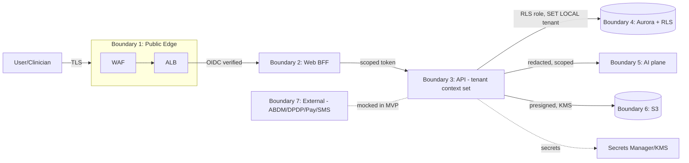

# AIIMS+ — Security Blueprint (Phase 3)

**Version:** 1.0 · **Owner:** Security Architect · **Status:** **Frozen (canonical, approved 2026-07-04)**
**Dependencies:** `../architecture/ARCHITECTURE-BLUEPRINT.md`, `../adr/` (ADR 0002/0005/0007/0008/0009),
`../database/DATABASE-ARCHITECTURE.md`, `../ddr/` (DDR 0002/0003/0006/0007/0011)
**Last Updated:** 2026-07-04 · **Review Trigger:** GOVERNANCE.md §6 flaw process; new threat class; new market/regulation.

This is the canonical security reference for AIIMS+. It **builds on** the frozen Architecture and Database
phases and does not redesign them. Where it hardens or makes concrete a security-relevant decision, it
records an **SDR** (`SDR-0001…`). A full consistency review against the frozen docs is in §29. No
implementation code is included.

> **Market context (grounded, Phase 1/2):** India v1 — DPDP Act 2023 + **DPDP Rules 2025 (notified
> 13 Nov 2025; core obligations enforceable 13 May 2027)** and ABDM (FHIR R4, consent-artifact sharing).
> HIPAA-readiness is designed-for, not certified (US is a Future market).

---

## 1. Security Principles

1. **Defense in depth** — no single control is trusted; isolation, encryption, authz, and audit overlap.
2. **Secure by design & by default** — every service ships locked-down; access is explicitly granted.
3. **Least privilege everywhere** — users, services, DB roles, IAM, and tokens get the minimum needed.
4. **Isolation at the database** — tenant separation is enforced by Postgres RLS, not app trust (DDR 0002).
5. **Assume breach** — minimize blast radius (per-record keys, network segmentation, short-lived creds).
6. **Everything auditable & tamper-evident** — security-relevant actions are logged immutably (DDR 0007).
7. **Data minimization** — collect/retain/expose the least PHI necessary; redact before AI/logs.
8. **No security by obscurity** — controls are explicit, reviewed, and testable (isolation CI gate).
9. **Compliance is a floor, not a ceiling** — DPDP/ABDM are minimums; we design above them.
10. **Humans decide clinically** — security never delegates clinical decisions to AI (Constitution).

---

## 2. Threat Model

**Methodology:** STRIDE over the trust boundaries in §3, prioritized by PHI impact.

| Threat (STRIDE) | Example against AIIMS+ | Primary controls |
|---|---|---|
| **Spoofing** | Stolen token; impersonated clinician/tenant | OIDC + MFA (prod), short-lived tokens, PKCE, BFF (SDR-0001) |
| **Tampering** | Altered clinical record or audit log | Optimistic concurrency (DDR 0009), hash-chained WORM audit (DDR 0007) |
| **Repudiation** | "I didn't access that record" | Immutable audit with actor + consent basis (DDR 0007, §15) |
| **Information disclosure** | Cross-tenant PHI leak; DB dump; log leakage | RLS FORCE (DDR 0002), field encryption (DDR 0006), no-PHI-in-logs (§16) |
| **Denial of service** | API flooding; expensive queries | WAF, rate limiting, query timeouts, autoscaling (§9, §17) |
| **Elevation of privilege** | Nurse → admin; app → DB superuser | RBAC PEP/PDP (SDR-0002), non-BYPASSRLS app role (DDR 0003) |

**Top-priority adversary scenarios:** (a) cross-tenant PHI access (the crown-jewel risk), (b) compromised
application credential, (c) insider misuse by a legitimate clinician, (d) supply-chain compromise of a
dependency/image, (e) prompt-injection exfiltration via the AI plane. Each maps to a mitigation below.

**Crown jewels:** patient PHI (identifiers + clinical data), ABHA identifiers, audit integrity, KMS keys,
Keycloak realm, and the tenant registry.

---

## 3. Trust Boundaries

Each boundary re-authenticates/authorizes; trust is never inherited transitively. The **highest-value
boundary is #4** (DB/RLS) — the last line of defense for tenant isolation.

---

## 4. Authentication Architecture (SDR-0001; implements ADR 0008)

- **Provider:** Keycloak (self-hosted, `ap-south-1`), OIDC/OAuth2. AIIMS+ is a relying party.
- **Flows:** Authorization Code + **PKCE**; browser uses a **BFF** (Next.js server) so no long-lived
  tokens live in the browser; machine-to-machine uses client-credentials with scoped service accounts.
- **Tokens:** short-lived JWT access tokens (minutes) + rotating refresh tokens; tenant/org/role claims.
- **MFA:** TOTP/WebAuthn — **Production** (structural hooks in MVP). SSO federation (hospital IdPs) —
  Production.
- **Verification:** signatures validated against Keycloak JWKS at the edge/API; `aud`, `iss`, `exp`, and
  tenant claims checked on every request.

## 5. Authorization Architecture — RBAC/ABAC (SDR-0002)

- **Model:** RBAC now (user/role/department/organization/resource — Master Ch. 6), **ABAC/ReBAC-ready**.
- **PEP/PDP:** NestJS guards are the Policy Enforcement Points; a central policy layer (`packages/authz`)
  is the Policy Decision Point — authorization is **never** ad hoc in controllers.
- **Least privilege & separation of duties:** clinical vs billing vs admin roles are distinct.
- **Break-glass:** emergency access is an explicit, time-boxed, heavily-audited role (Production) — access
  is granted but every action is flagged for review; never a silent super-role.
- **Consent-aware access (Production):** authorization can require a valid consent artifact (ADR 0004) for
  cross-provider data access.

## 6. Tenant Isolation Security (SDR-0003; implements DDR 0002/0003/0008)

Defense-in-depth, database-anchored:
1. **Postgres RLS with `FORCE`** on every tenant-scoped table; policy `tenant_id = current_setting(...)`,
   **fail-closed** when unset.
2. **Non-privileged app role** (`aiims_app`, no owner, no `BYPASSRLS`) — a forgotten `WHERE` cannot leak.
3. **Transaction-scoped `SET LOCAL app.tenant_id`** — safe under RDS Proxy pooling; never session-level.
4. **Tenant-scoped FKs & uniques** (DDR 0008) — cross-tenant references are structurally impossible.
5. **Mandatory cross-tenant isolation CI gate** (DDR 0002 / DB §17) — merge-blocking; also the guardrail
   against Drizzle's RLS-policy footgun (DDR 0011).
6. **Dedicated-DB promotion** for the highest-sensitivity tenants (ADR 0002) — physical isolation on demand.

## 7. Identity Management

- **Users:** Keycloak subject ↔ `platform.app_user` (DB §5); no passwords stored by AIIMS+.
- **Lifecycle:** joiner/mover/leaver via role assignments (`platform.user_role`); deprovisioning revokes
  Keycloak access and disables the app_user, audited.
- **Service identities:** each service/worker/AI-plane has its own scoped machine identity (IAM task role
  + Keycloak client), never shared.
- **Patient identity:** ABHA linkage via the ABDM adapter (mock in MVP); ABHA numbers are encrypted (§13).

## 8. Session Management

- Access tokens short-lived; **refresh-token rotation** with reuse detection; server-side revocation via
  Keycloak. Idle + absolute session lifetimes enforced.
- BFF holds tokens in an httpOnly, Secure, SameSite cookie session; **no tokens in localStorage** (blueprint §8).
- Sensitive operations (break-glass, admin) may require re-authentication/step-up MFA (Production).

## 9. API Security (SDR-0009)

- **Edge:** WAF (OWASP rules), TLS 1.2+ only, strict CORS allowlist, security headers (HSTS, CSP,
  X-Content-Type-Options, etc.).
- **Input:** Zod validation from `packages/api-contracts` on every request (shared client/server schemas);
  reject-by-default.
- **Rate limiting & quotas** (Redis) per tenant/user/IP; per-endpoint query timeouts to bound expensive
  queries.
- **AuthN/AuthZ/tenant/audit** as global middleware — no endpoint can bypass them (blueprint §13).
- **Idempotency keys** on mutating clinical endpoints; consistent error envelope that **never leaks PHI or
  stack traces**.
- **FHIR boundary** (ABDM) is separate and encrypted (§25).

## 10. Encryption Strategy (SDR-0004/0005)

- **In transit:** TLS everywhere (edge, service-to-service, DB connections, S3); internal mTLS is a
  Production hardening option.
- **At rest:** Aurora storage encryption (KMS), S3 SSE-KMS, EBS/backup encryption, Redis encryption.
- **Field-level (application):** direct identifiers (ABHA, phone, email, Aadhaar refs) are envelope-
  encrypted with **per-record data keys** (DDR 0006) to enable crypto-shredding; blind indexes (keyed
  HMAC) support exact-match lookups without decryption.
- **Rationale (ratifies DDR 0006):** encrypt identifiers, not all PHI — preserves queryability/indexing
  while delivering erasure/crypto-shred. Security sign-off recorded in SDR-0004.

## 11. Key Management — KMS/CMK (SDR-0005)

- **AWS KMS** with a **CMK hierarchy**: separate CMKs for DB storage, S3, secrets, and PHI field-data
  keys — blast-radius isolation and independent rotation.
- **Envelope encryption:** `GenerateDataKey` produces per-record/per-subject data keys wrapped by the PHI
  CMK; plaintext data keys exist only in memory (DDR 0006). `enc_key_ref` on the row points to the wrapped key.
- **Rotation:** annual CMK rotation (automatic) + key-policy-scoped grants; data-key re-wrap on rotation.
- **Per-tenant CMK** for dedicated/high-sensitivity tenants (Production) — enables tenant-level crypto-shred.
- **Access:** KMS key policies + least-privilege IAM; no human standing access to production PHI CMK.

## 12. Secrets Management (SDR-0006)

- **AWS Secrets Manager** for all runtime secrets (DB creds, Keycloak client secrets, provider keys);
  **nothing sensitive in code, images, or env files** in the repo.
- **Injection** at runtime via task roles (IAM); rotation enabled (esp. DB creds via RDS Proxy).
- **CI/CD** uses OIDC-federated, short-lived cloud credentials — no long-lived keys in GitHub.
- **Detection:** secret scanning in CI (§22) blocks committed secrets.

## 13. PHI Protection (SDR-0004)

- **Classification:** data tagged (PHI / PII / operational / public); PHI gets the strictest controls.
- **Minimization:** only required PHI is collected; direct identifiers field-encrypted (DDR 0006).
- **Access:** RLS + RBAC + audit on every PHI read/write; consent basis linked (ADR 0004).
- **No PHI in:** logs, metrics, traces, error messages, AI prompts, or non-prod environments (synthetic
  data only in dev/staging).
- **Erasure:** crypto-shred once retention windows expire (ADR 0009 / DDR 0013) — durations pending legal.

## 14. Database Security (implements DDR 0002/0003/0007/0011)

- **RLS FORCE + non-privileged app role** (the core control, §6).
- **Role separation:** `aiims_owner`/`aiims_migrator`/`aiims_app`/`aiims_readonly` (DDR 0003).
- **Least-privilege grants** per bounded-context schema (DDR 0004); app has no DDL.
- **Migration governance:** RLS/roles as reviewed SQL; drizzle-kit RLS management disabled; policy-removal
  CI alert (DDR 0011).
- **Network:** Aurora in private subnets, no public endpoint; TLS-required connections; access via RDS Proxy.
- **Auditability:** DB-level logging (pgAudit optional) complements application audit (§15).

## 15. Audit & Compliance (SDR-0007; implements DDR 0007)

- **Append-only, hash-chained audit log** fed by the transactional outbox — atomic with the business write.
- Captures actor/tenant/role, action, resource, consent basis, outcome, source — **no PHI payloads**.
- **Immutability:** `UPDATE`/`DELETE` revoked from `aiims_app`; **WORM** archival (S3 Object Lock, compliance
  mode) in Production; scheduled **chain-integrity verifier**.
- **Compliance use:** satisfies DPDP accountability, ABDM audit expectations, and the Constitution's audit
  mandate. Access to audit data is itself audited and least-privilege.

## 16. Logging & Monitoring (SDR-0010)

- **Structured JSON logs** with correlation + tenant + actor IDs; **PHI redaction pipeline** guarantees no
  PHI/secret reaches logs.
- **OpenTelemetry** traces/metrics; security signals: authN failures, authz denials, rate-limit hits,
  RLS/isolation anomalies, audit-integrity failures.
- **Alerting/SIEM:** SLO + security alerts in MVP; SIEM integration and anomaly detection in Production.
- **Retention** of security logs per policy; tamper-resistant storage for security-relevant events.

## 17. Network Security (SDR-0008)

- **VPC segmentation:** public subnets (ALB/WAF only), private subnets (services), isolated data subnets
  (Aurora/Redis) — data stores have **no public route**.
- **WAF** (OWASP + rate rules) at the edge; security groups default-deny; egress restricted via NAT.
- **TLS everywhere**; internal mTLS optional (Production).
- **DDoS:** AWS Shield (Standard) + WAF; autoscaling absorbs load spikes.

## 18. Infrastructure Security (SDR-0008/0012)

- **IaC (Terraform)** — all infra reviewed, versioned, scanned (tfsec/checkov) pre-apply.
- **Least-privilege IAM** roles per service; no wildcard admin; CloudTrail + GuardDuty enabled.
- **Immutable, minimal container images**; no SSH into tasks (Fargate); patched base images.
- **Environment isolation** (dev/staging/prod separate accounts/VPCs where practical).

## 19. File Storage Security (implements blueprint §16)

- **S3 private buckets**, per-tenant key prefixes, **SSE-KMS**, **block public access** enforced.
- Access only via **short-lived presigned URLs**; no long-lived public objects.
- **Object Lock (WORM)** for audit archives and legally-retained documents.
- Imaging/DICOM objects encrypted; metadata (not the object) in the DB; PACS is Production/Future.

## 20. AI Security (SDR-0011; implements blueprint §10/§28, Constitution)

- **Isolated AI plane** reached only via the `AiGatewayModule` port; operational-only, **never clinical
  decisions**.
- **PHI redaction/tokenization before any model call**; tenant-scoped RAG (no cross-tenant retrieval).
- **Prompt-injection defenses:** treat retrieved/user content as untrusted, constrain tool/output scope,
  output validation; the AI plane has **no write path** to clinical records without human sign-off.
- **Full audit** of AI inputs/outputs (redacted); models never presented as clinical authority.
- **Availability:** AI failure never blocks clinical workflows (off the critical path).

## 21. Supply Chain Security (SDR-0012)

- **Dependency management:** pinned/locked versions; automated vulnerability scanning (Dependabot/Snyk);
  license checks. Drizzle v1.0 stability confirmed at kickoff (ADR 0011 guardrail).
- **SBOM** generated per build; **image scanning** (ECR/Trivy); **image signing/provenance** (cosign/SLSA)
  in Production.
- **CI hardening:** least-privilege OIDC to AWS, no long-lived secrets, protected branches, required reviews.
- **Third-party services** (ABDM/DPDP/payment/SMS) integrated only via vetted adapters (mock in MVP).

## 22. Secure Development Lifecycle (SDR-0012)

- **Shift-left in CI:** SAST, dependency scan, secret scan, container scan, IaC scan, and the **cross-tenant
  isolation test** — all merge-blocking.
- **Code review** mandatory; security-sensitive changes (authz, RLS, crypto, secrets) require security review.
- **Threat modeling** for each new bounded context/integration; **no `console`-logged PHI** lint rule.
- **Least-privilege by default** in new modules; security acceptance criteria per feature.

## 23. Incident Response (SDR-0013)

- **Plan:** detect → triage → contain → eradicate → recover → post-mortem; defined severities and on-call.
- **Containment levers:** revoke tokens/keys, isolate a tenant/service, rotate secrets, disable a
  feature flag.
- **Forensics:** immutable audit + logs support investigation; preserve evidence.
- **Breach notification:** notify the **DPDP Data Protection Board and affected data principals** within the
  DPDP-mandated window. *Exact timelines to be confirmed with counsel (tracked as a legal-deferred item);
  design assumes prompt notification + a detailed follow-up report.*
- **Runbooks** versioned in `/operations/` (Ops phase).

## 24. Disaster Recovery Security (implements ADR 0007)

- Backups and cross-region snapshots (`ap-south-2`) are **encrypted** (KMS) and access-controlled; audit
  WORM store replicated.
- **DR restores are tested** (not assumed); restored environments re-apply RLS, roles, and secrets — no
  weakened posture during failover.
- Backup deletion/restore actions are audited; key material required for restore is protected in KMS.

## 25. Compliance Mapping (DPDP, ABDM, HIPAA-ready)

| Requirement | AIIMS+ control | Phase |
|---|---|---|
| **DPDP** lawful processing & consent | Unified Consent Service (ADR 0004); consent basis in audit | MVP structure / Prod integration |
| **DPDP** data principal rights (access/correction/erasure) | Retention + crypto-shred (ADR 0009/DDR 0013); rights portal | Prod |
| **DPDP** security safeguards | Encryption, RLS, least privilege, audit (this doc) | MVP |
| **DPDP** breach notification | IR process §23; Board + principal notification | Prod (legal-confirmed) |
| **DPDP** SDF duties (DPO/DPIA/audit) | Governance + this blueprint; DPIA process | Prod (classification pending) |
| **ABDM** consent-artifact sharing | Consent Service + ABDM adapter (ADR 0006) | Prod (mock in MVP) |
| **ABDM** encrypted FHIR exchange | TLS + encrypted bundles at the adapter (§25/blueprint §27) | Prod |
| **ABDM** audit | Hash-chained audit (DDR 0007) | MVP |
| **HIPAA-ready** (US Future) | Encryption, access control, audit, BAA-able architecture | Future |

*Data residency: all PHI in Indian regions (ADR 0007). SDF classification + exact DPDP timelines are
legal-deferred (Open Issues C-1/C-2) — do not block MVP.*

## 26. Security Risks & Mitigations

| ID | Risk | Severity | Mitigation |
|---|---|---|---|
| S-1 | Cross-tenant PHI leak (crown-jewel) | **Critical** | RLS FORCE + non-BYPASSRLS app role + isolation CI gate + tenant-scoped FKs (§6) |
| S-2 | Compromised app credential | High | Short-lived tokens, least-privilege IAM/DB, secrets rotation, anomaly alerts |
| S-3 | Insider misuse by legitimate clinician | High | RBAC least privilege, full audit, break-glass review, consent-aware access |
| S-4 | Drizzle silent RLS-policy drop | High | RLS as reviewed SQL, policy-removal CI alert, isolation gate (DDR 0011) |
| S-5 | Supply-chain compromise | High | Dep/image scanning, SBOM, signing, pinned versions (§21) |
| S-6 | Prompt-injection PHI exfiltration via AI | Medium | Redaction, tenant-scoped RAG, no write path, output validation, audit (§20) |
| S-7 | PHI in logs/prompts | High | Redaction pipeline + lint rules + no-PHI policy (§13/§16) |
| S-8 | Key compromise | High | CMK hierarchy, per-tenant CMK (prod), rotation, no standing human access (§11) |
| S-9 | Audit tampering | Medium | Hash chain + WORM + verifier + revoked UPDATE/DELETE (§15) |
| S-10 | DoS on API/DB | Medium | WAF, rate limits, query timeouts, autoscaling, Shield (§9/§17) |

## 27. Security Decision Summary

| SDR | Decision | Confidence |
|---|---|---|
| 0001 | Identity & token architecture (Keycloak/OIDC/PKCE/BFF) | High |
| 0002 | Authorization: RBAC-now, ABAC-ready, PEP/PDP, break-glass | High |
| 0003 | Tenant isolation defense-in-depth | High |
| 0004 | PHI protection & field encryption (ratifies DDR-0006) | High |
| 0005 | Key management: KMS CMK hierarchy + envelope + per-tenant CMK | High |
| 0006 | Secrets management (Secrets Manager, no secrets in repo) | High |
| 0007 | Audit integrity & tamper-evidence | High |
| 0008 | Network & infrastructure security | High |
| 0009 | API security controls | High |
| 0010 | Logging/monitoring & PHI redaction | High |
| 0011 | AI security boundary controls | High |
| 0012 | Supply chain & secure SDLC | High |
| 0013 | Incident response & breach notification | Med-High |

## 28. Security Freeze Checklist

- [x] Principles, threat model (STRIDE), trust boundaries (§1–§3)
- [x] AuthN, AuthZ, tenant isolation, identity, session (§4–§8) → SDR-0001/0002/0003
- [x] API, encryption, KMS, secrets, PHI (§9–§13) → SDR-0004/0005/0006/0009
- [x] DB, audit, logging, network, infra, storage security (§14–§19) → SDR-0007/0008/0010
- [x] AI, supply chain, SDLC, IR, DR security (§20–§24) → SDR-0011/0012/0013
- [x] Compliance mapping, risks, decision summary (§25–§27)
- [x] Consistency review vs frozen docs (§29) — **no contradictions**
- [ ] **Deferred (non-blocking):** DPDP breach-notification exact timelines + SDF classification (legal);
      per-tenant CMK, MFA/SSO, WORM, SIEM, image signing = Production hardening.

## 29. Consistency Review vs Frozen Foundation

Checked against Architecture Blueprint, ADRs, Database Architecture, DDRs:

| Frozen source | Security position | Consistent? |
|---|---|---|
| ADR 0002 / DDR 0002/0003 (RLS tenancy) | §6 anchors isolation on RLS FORCE + non-priv role | ✅ Yes — extends, no change |
| ADR 0008 (Keycloak identity) | §4 uses Keycloak OIDC + BFF | ✅ Yes |
| ADR 0009 / DDR 0013 (retention/erasure) | §13/§25 crypto-shred; durations legal-deferred | ✅ Yes |
| DDR 0006 (encrypt identifiers only) | §10/§13 ratifies via SDR-0004 | ✅ Yes — **closes the pending sign-off** |
| DDR 0007 (audit) | §15 tamper-evident, WORM | ✅ Yes |
| DDR 0011 (migration/RLS guardrails) | §14 policy-removal alert, isolation gate | ✅ Yes |
| Blueprint §10/§28 (AI boundaries) | §20 operational-only, redaction, no write path | ✅ Yes |
| ADR 0007 (residency/DR) | §24 encrypted DR in Indian regions | ✅ Yes |

**Result: no contradictions and no critical flaws found.** SDR-0004 resolves the one open cross-phase item
(DDR-0006 security sign-off). The Security Blueprint is internally consistent with the frozen Architecture
and Database phases.

**Freeze status: READY TO FREEZE** on approval. Deferred items are Production hardening or legal
parameters — none blocks the freeze or downstream phases.

*End of Security Blueprint v1.0.*
